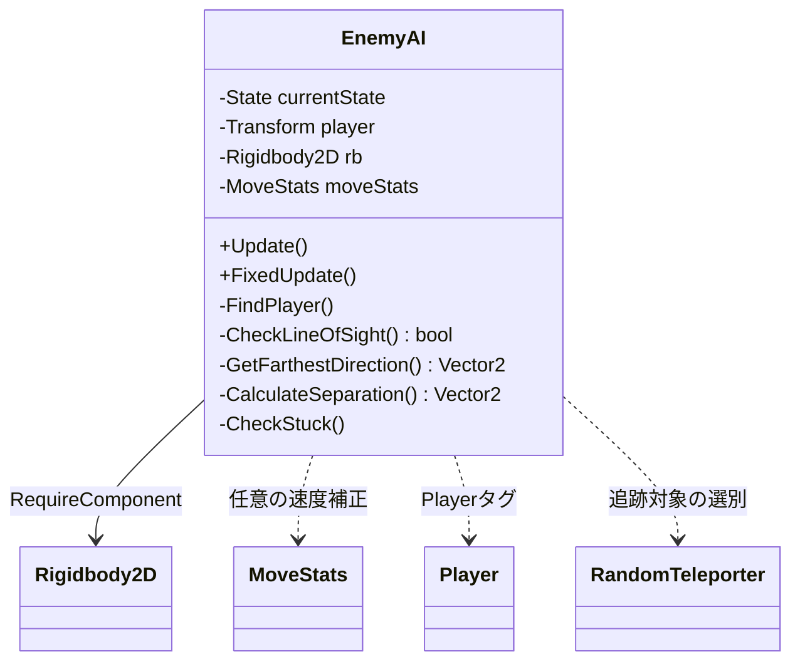
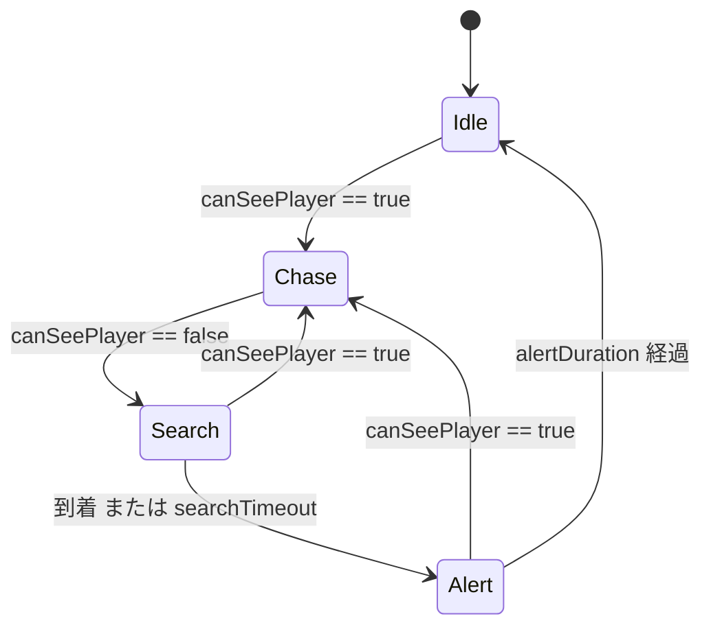
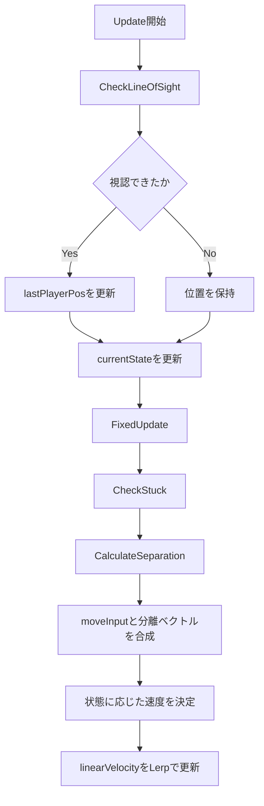
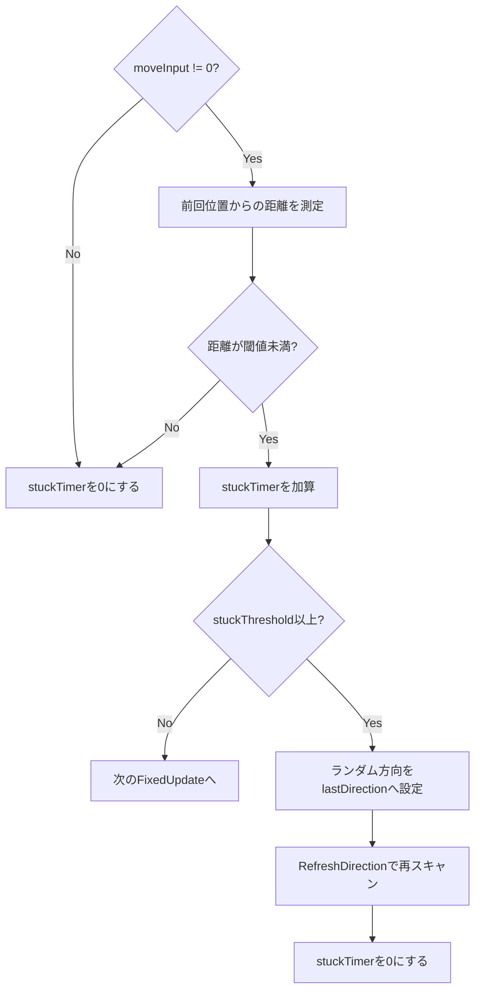

# EnemyAI 実装仕様

この文書は、`Assets/Script/Enemy/AI/EnemyAI.cs` に実装されている、2D トップダウン敵 AI の仕様と処理順をまとめたものです。
対象クラスは、プレイヤーの視認、追跡、最後に見た場所の捜索、周囲の障害物を避ける巡回、敵同士の分離移動を一つの `MonoBehaviour` で処理します。

> [!warning] この文書の適用範囲
> `SkeletonEnemyAI` などの派生・類似 AI は、同じ状態名を使用していてもパラメータや移動制約が異なります。この文書の数値と挙動は、基本クラス `EnemyAI` の実装を基準にしています。

## 1. 設計上の役割

`EnemyAI` の責務は「どちらへ、どの速度で動くか」を決め、`Rigidbody2D` の速度へ反映することです。攻撃、ダメージ、アニメーション、スポーン処理は別コンポーネントの責務です。

主な特徴は次のとおりです。

- プレイヤーを直接追えるときは、プレイヤー方向へ移動する。
- 視界を失うと、最後に視認した位置へ向かう。
- 到着または制限時間経過後は、一定時間だけ周囲を探索する。
- 視認していないときは、複数方向への `CircleCast` で開けた方向を選ぶ。
- 近くの `Enemy` タグのオブジェクトから離れる分離ベクトルを加える。
- 入力があるのに実際の移動が小さい状態が続くと、進行方向を再抽選する。

## 2. 依存関係と初期化



### 必須コンポーネント

クラスには `[RequireComponent(typeof(Rigidbody2D))]` が付いているため、`Rigidbody2D` は必須です。`FixedUpdate()` で `rb.linearVelocity` を更新するので、物理移動を無効にしたオブジェクトでは意図した挙動になりません。

### 任意コンポーネント

`MoveStats` が同じ GameObject に付いている場合、基礎速度を `ApplySpeed()` に通して補正します。付いていない場合は Inspector の `walkSpeed` または `runSpeed` がそのまま使われます。

### `Start()` の初期化

`Start()` では次の処理を行います。

1. `Rigidbody2D` を取得する。
2. スタック判定用の前回位置を現在位置で初期化する。
3. `MoveStats` を取得する。
4. `Player` タグのオブジェクト一覧から、`RandomTeleporter` を持つ最初のオブジェクトを追跡対象にする。
5. `Physics2D.queriesStartInColliders` を `true` に設定する。

> [!important] 追跡対象の条件
> `FindPlayer()` は `Player` タグだけでは対象にせず、`RandomTeleporter` コンポーネントも確認します。タグを付けただけのプレイヤーは、このスクリプトからは選択されません。

## 3. 状態機械

状態は `Idle`、`Chase`、`Search`、`Alert` の4種類です。毎フレーム `Update()` の先頭で視認判定を行い、その結果を現在状態の更新処理へ渡します。



### `Idle`: 徘徊

プレイヤーを視認していない通常状態です。`scanTimer` が0以下になるたびに `RefreshDirection()` を呼び、`GetFarthestDirection()` で次の方向を選びます。

- 視認すると即座に `Chase` へ移行する。
- 視認していない間は `scanInterval` 秒ごとに方向を更新する。
- 速度は `walkSpeed`。
- 方向選択では障害物までの距離、前回方向、宝箱ボーナスを評価する。

### `Chase`: 追跡

プレイヤーを視認できている状態です。障害物回避スキャンではなく、プレイヤーの位置から自分の `CenterPos` への正規化方向を `moveInput` に設定します。

- 視認中は毎フレームプレイヤー方向を更新する。
- 速度は `runSpeed`。
- 視界を失うと `Search` へ移行し、`currentSearchTimer` を0に戻す。
- 追跡中に最後に視認した位置は `lastPlayerPos` に保存される。

### `Search`: 捜索

最後に視認した位置へ移動する状態です。`lastPlayerPos` は「現在のプレイヤー位置」ではなく、視認が成立した最後の地点です。

- プレイヤーを再び視認すると `Chase` に戻る。
- `lastPlayerPos` までの距離が `0.2` 未満になると `Alert` へ移行する。
- `currentSearchTimer` が `searchTimeout` 以上になっても `Alert` へ移行する。
- 速度は `runSpeed`。

### `Alert`: 警戒

最後に見た場所へ到着した後、または捜索を打ち切った後の探索状態です。

- `alertTimer` を `alertDuration` から減算する。
- `scanTimer` が0以下になるたび、`fastScanInterval` 間隔で周囲を再スキャンする。
- プレイヤーを視認すると `Chase` に戻る。
- `alertDuration` が経過すると `Idle` に戻る。
- `EnemyAI` 本体では `Alert` も `runSpeed` を使う。警戒中に歩行速度へ下がる、という説明は正確ではない。

## 4. 1フレームの処理順



`Update()` は判断と移動入力の生成、`FixedUpdate()` は物理速度の更新を担当します。そのため、`moveInput` は状態更新側で保持され、次の物理フレームで使用されます。

## 5. プレイヤー検知と視線判定

### 検知対象の選択

`FindPlayer()` は `GameObject.FindGameObjectsWithTag("Player")` の結果を順番に調べ、`RandomTeleporter` が付いた最初のオブジェクトを `player` に保存します。複数のプレイヤー候補が存在する場合、距離や最寄り順では選びません。

### `CheckLineOfSight()`

視線判定は次の条件をすべて満たした場合だけ `true` になります。

1. `player` が存在する。
2. プレイヤー位置と `CenterPos` の距離が `detectRange` 以下である。
3. プレイヤー方向へ投げた `CircleCast` が何かにヒットする。
4. 最初にヒットしたコライダーが `Player` タグを持つ。

```text
targetPos = player.position + playerPositionOffset
direction = normalize(targetPos - CenterPos)
distance = Distance(CenterPos, targetPos)
startPos = CenterPos + direction * rayLaunchRadius
hit = CircleCast(startPos, checkRadius, direction, distance, detectionMask)
canSeePlayer = hit.collider != null && hit.collider.CompareTag("Player")
```

この実装では、壁などの遮蔽物がプレイヤーより先にヒットすると視認失敗になります。逆に、`detectionMask` にプレイヤーのレイヤーが含まれていない場合も、プレイヤーを最初のヒットとして認識できません。

`rayOffset` は敵の Transform 原点ではなく、視線・スキャンの基準点をずらすために使われます。`playerPositionOffset` はプレイヤーの足元や中心など、判定したい部位へ照準点をずらすための値です。

## 6. 周囲スキャンと方向評価

### `GetFarthestDirection()`

`rayCount` 本の方向を360度に均等配置し、各方向へ `CircleCast` を行います。ヒットしなければ距離を `detectRange` とみなし、より遠くまで進める方向を高く評価します。

各方向のスコアは、実装上は次の形です。

$$
\\text{score} = \\text{distance} \\times \\text{weight} + \\text{bonus}
$$

前回方向との内積を $d = \\operatorname{Dot}(\\text{direction}, \\text{lastDirection})$ とすると、重みは次のように補間されます。

$$
\\text{weight} = \\operatorname{Lerp}(0.2,\\ \\text{forwardBias},\\ \\frac{d+1}{2})
$$

したがって、前回方向と同じ方向ほど `forwardBias` に近い重みになり、反対方向ほど `0.2` に近くなります。`forwardBias` は速度や角度ではなく、方向選択の優先度です。

### 宝箱ボーナス

スキャン方向の最初のヒットが `Chest` タグだった場合、次のボーナスを加算します。

$$
\\text{bonus} = \\text{chestBonus} + (\\text{detectRange} - \\text{distance})
$$

これは宝箱をプレイヤーの代わりに検知する仕組みではありません。`Idle` または `Alert` の方向選択で、宝箱へ向かう方向を優先しやすくする仕組みです。

### `CircleCast` の意味

点の `Raycast` ではなく半径 `checkRadius` の円を進めるため、敵の体幅を考慮した障害物判定になります。`rayLaunchRadius` はキャスト開始点を `CenterPos` から方向へ押し出す距離です。値を大きくすると、敵の中心付近ではなく前方から判定を開始します。

## 7. 敵同士の分離

`CalculateSeparation()` は `Physics2D.OverlapCircleAll(transform.position, separationRadius)` で近傍コライダーを取得し、`Enemy` タグを持つ他オブジェクトだけを対象にします。

各敵について、次の反発ベクトルを加算します。

$$
\\text{separationVec} \\mathrel{+}= \\frac{\\operatorname{normalize}(\\text{selfPosition}-\\text{otherPosition})}{\\max(\\text{distance}^2,\\ 0.01)}
$$

分離ベクトルに `separationWeight` を掛け、`magnitude > 0.1` のときだけ `moveInput` と合成します。基本クラスの合成は次の処理です。

```text
separation = CalculateSeparation() * separationWeight
finalForce = moveInput
if separation.magnitude > 0.1:
    finalForce = Lerp(moveInput, normalize(moveInput + separation), 0.7)
```

これは敵を完全に押し出す物理処理ではなく、目標移動方向を補正するステアリング処理です。敵の Collider の設定や Rigidbody2D の物理挙動によっては、重なりを完全には防げません。

## 8. 速度と物理移動

状態による基礎速度は次のとおりです。

| 状態 | 基礎速度 |
| --- | ---: |
| `Idle` | `walkSpeed` |
| `Chase` | `runSpeed` |
| `Search` | `runSpeed` |
| `Alert` | `runSpeed` |

`MoveStats` がある場合は、基礎速度を `ApplySpeed(baseSpeed)` に渡して最終速度を得ます。移動方向があるときは、次のように現在の物理速度を補間します。

$$
\\text{linearVelocity} = \\operatorname{Lerp}(\\text{currentVelocity},\\ \\operatorname{normalize}(\\text{finalForce}) \\times \\text{speed},\\ \\text{acceleration} \\times \\Delta t)
$$

移動入力がゼロの場合も、目標速度をゼロとして補間するため、即時停止ではなく減速します。`acceleration` を大きくすると目標速度へ早く近づき、小さくすると滑りやすくなります。

> [!bug] 実装確認が必要な箇所
> 現在の `EnemyAI.cs` では、`MoveStats.ApplySpeed(baseSpeed)` を連続して2回呼んでいるコードが見られます。速度補正が二重適用される実装になっている可能性があるため、`MoveStats` の仕様を確認し、意図しない場合はスクリプト側を1回の呼び出しへ整理してください。

## 9. スタック解除

`CheckStuck()` は `moveInput` がゼロでないのに、前回の物理フレームからの移動距離が `minMoveDistance * Time.fixedDeltaTime` 未満の状態を検出します。



スタックと判定された場合、0〜360度のランダム方向を `lastDirection` に設定してから `RefreshDirection()` を実行します。ランダム方向へ直接テレポートするわけではなく、次回の方向評価に前回方向として影響させるだけです。

## 10. Inspector パラメータ

| グループ | 変数 | 型 | 初期値 | 役割 |
| --- | --- | ---: | ---: | --- |
| ターゲット | `detectRange` | `float` | `15.0` | 視線判定と周囲スキャンの最大距離 |
| ターゲット | `detectionMask` | `LayerMask` | `392` | `CircleCast` が検出するレイヤー |
| ターゲット | `rayOffset` | `Vector2` | `(0, -0.3)` | 敵側の判定中心のオフセット |
| ターゲット | `playerPositionOffset` | `Vector2` | `(0, -0.3)` | プレイヤー側の照準位置のオフセット |
| 移動 | `walkSpeed` | `float` | `2.0` | `Idle` の基礎速度 |
| 移動 | `runSpeed` | `float` | `3.0` | `Chase`、`Search`、`Alert` の基礎速度 |
| 移動 | `acceleration` | `float` | `3.0` | 速度補間の強さ |
| 移動 | `checkRadius` | `float` | `0.3` | 視線・障害物 `CircleCast` の半径 |
| スタック | `stuckThreshold` | `float` | `1.0` | スタックと判断する継続時間 |
| スタック | `minMoveDistance` | `float` | `0.05` | 1秒あたりの基準移動距離 |
| スキャン | `rayCount` | `int` | `16` | 360度に配置するキャスト本数 |
| スキャン | `scanInterval` | `float` | `0.3` | `Idle` の方向更新間隔 |
| スキャン | `fastScanInterval` | `float` | `0.2` | `Alert` の方向更新間隔 |
| スキャン | `forwardBias` | `float` | `8.0` | 前回方向を継続する優先度 |
| スキャン | `rayLaunchRadius` | `float` | `0.7` | キャスト開始点の前方オフセット |
| スキャン | `chestBonus` | `float` | `30.0` | `Chest` ヒット時の基本加点 |
| 分離 | `separationRadius` | `float` | `3.0` | 分離対象を探す半径 |
| 分離 | `separationWeight` | `float` | `0.2` | 分離ベクトルの強さ |
| 捜索 | `searchTimeout` | `float` | `1.0` | `Search` の最大継続時間 |
| 警戒 | `alertDuration` | `float` | `7.0` | `Alert` の継続時間 |
| デバッグ | `showDebug` | `bool` | `false` | Scene ビューへの可視化の有無 |

## 11. デバッグ表示

`showDebug` が `true` のとき、次の情報が表示されます。

- 周囲スキャンの `Debug.DrawRay`: 距離に応じて赤から緑、宝箱を評価した方向は青。
- 視線判定の `Debug.DrawLine`: プレイヤーが最初のヒットなら青、それ以外は黒。
- マゼンタのワイヤー球: `CenterPos` と `rayLaunchRadius`。
- 黄色のワイヤー球: `CenterPos` と `checkRadius`。
- 赤いワイヤー球: `Search` または `Alert` 中の `lastPlayerPos`。

これらは主に Scene ビュー用のデバッグ情報です。ゲーム画面へ描画される UI やエフェクトではありません。

## 12. 調整時の確認ポイント

### プレイヤーを見つけない

1. プレイヤーに `Player` タグが付いているか確認する。
2. プレイヤーに `RandomTeleporter` が付いているか確認する。
3. プレイヤーと遮蔽物のレイヤーが `detectionMask` に含まれているか確認する。
4. `detectRange` と `playerPositionOffset` が適切か確認する。
5. `showDebug` を有効にし、視線用の黒い線がどこで遮られているか確認する。

### 壁へ突き進む

`checkRadius` が敵の実際の幅より小さすぎないか、`rayLaunchRadius` が大きすぎて判定開始点が不自然に前へ出ていないか確認します。`detectionMask` に壁のレイヤーが含まれていない場合、障害物までの距離が正しく得られません。

### 敵が集まりすぎる

`separationRadius` を大きくするとより遠い敵を考慮し、`separationWeight` を大きくすると反発方向を強くします。ただし、値を大きくしすぎると目標方向より分離が優先され、隊列が不安定になります。

### 角で停止する

`stuckThreshold` を短くすると早く再スキャンしますが、狭い場所で方向が頻繁に変わる可能性があります。`minMoveDistance` は `FixedUpdate` の時間刻みを掛けて判定されるため、単純な「1フレームあたりの距離」ではありません。

## 13. パフォーマンスと保守上の注意

- `GetFarthestDirection()` は1回の更新につき最大 `rayCount` 回の `CircleCast` を行う。
- `CheckLineOfSight()` も毎フレーム `CircleCast` を1回行う。
- `CalculateSeparation()` は `OverlapCircleAll` で近傍コライダー配列を生成する。
- 敵の数が多い場合は、`rayCount`、`scanInterval`、`separationRadius` の組み合わせが負荷に影響する。
- `Physics2D.queriesStartInColliders` はグローバル設定なので、このコンポーネントの初期化が他の物理クエリにも影響する可能性がある。
- `FindPlayer()` は `Start()` と、`Idle` 中に対象が未設定または非アクティブになった場合に実行される。毎フレームの検索ではない。

## 14. 現在の制約

この AI は経路探索グラフや NavMesh を使っていません。`CircleCast` でその瞬間に開けている方向を選ぶ局所的なステアリング方式です。そのため、次のような状況では限界があります。

- 壁で完全に囲まれた場所からの脱出経路を保証しない。
- 複雑な迷路で、目的地へ到達できる経路を保証しない。
- `Search` 中は最後に見た地点へ直線的に向かうため、壁を回り込む経路探索はしない。
- 複数のプレイヤー候補から、最も近い対象や最も危険な対象を選ぶわけではない。
- 宝箱への関心は `Idle` と `Alert` の方向評価にのみ反映され、追跡中のプレイヤー方向を上書きしない。
