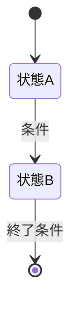

[[ArmorDefense.cs]]
[[allocator-rewindable]]
# ゲーム要素 設定・実装テンプレート

モンスター、アイテム、装備、ギミックなどを考えるときに複製して使う。未確定の項目は「未定」、該当しない項目は「なし」と記入する。設定と実装仕様を分け、ゲーム内での役割やプレイヤーに見える挙動が伝わるようにする。

---

## 基本情報

- **要素名（日本語）**：
- **要素名（内部名・英語）**：
- **分類**：モンスター / アイテム / 装備 / ギミック / その他
- **状態**：アイデア / 設計中 / 実装中 / 実装済み / 要調整
- **関連する設定・要素**：

## コンセプト・世界設定

- **一言コンセプト**：
- **世界での由来・背景**：
- **生息地・入手場所・出現条件**：
- **見た目・大きさ・色**：
- **性格・生態・用途**：
- **プレイヤーに伝えたい印象**：

## ゲーム内での役割

- **プレイヤーが遭遇・入手する状況**：
- **ゲームプレイ上の役割**：
- **プレイヤーに促す判断・行動**：
- **他の要素との違い**：
- **想定する難易度・進行段階**：

## プレイヤーから見える仕様

- **通常時の挙動・効果**：
- **発動条件・操作方法**：
- **発動前の予兆・表示**：
- **効果時間・クールダウン**：
- **解除・終了条件**：
- **失敗時・無効時の挙動**：
- **撃破時・使用後・取得時の結果**：

## 数値・バランス

| 項目 | 値・範囲 | 補足 |
|---|---:|---|
| HP / 耐久度 |  |  |
| 攻撃力 / 効果量 |  |  |
| 移動速度 / 射程 |  |  |
| 発生確率 / ドロップ率 |  |  |
| 重量 / スタック数 / 価格 |  |  |
| その他 |  |  |

※ 数値は単位を明記し、仮値には「仮」と付ける。

## 実装仕様（Unity）

- **実装方式**：既存機能の流用 / 既存機能の拡張 / 新規実装
- **関連するスクリプト・クラス**：
- **Prefab / ScriptableObject / データ**：
- **必要なコンポーネント**：
- **Inspector で設定する値**：
- **生成・配置・取得・破棄の流れ**：
- **既存システムとの接続先**：例：HP、攻撃、インベントリ、ドロップ、ステージ出現設定
- **セーブ・ロードへの影響**：

### 挙動の流れ

1. **開始条件**：
2. **通常処理**：
3. **終了条件**：
4. **終了後の処理**：

### 状態遷移（必要な場合）

## 演出・操作感

- **アニメーション・見た目の変化**：
- **効果音・BGM**：
- **エフェクト**：
- **UI・ログ・説明文**：
- **操作・フィードバック上の注意**：

## 例外・確認項目

- **同時発生・連続使用時**：
- **壁・段差・画面外など地形との関係**：
- **死亡・ステージ移動・一時停止時**：
- **他の効果との重複・競合**：
- **プレイヤーに誤解されそうな点**：

## 作業メモ

- **未決定事項**：
- **実装・調整タスク**：
- **確認方法（どの場面で何を見るか）**：
- **関連ファイルへのリンク**：
- **更新日**：
