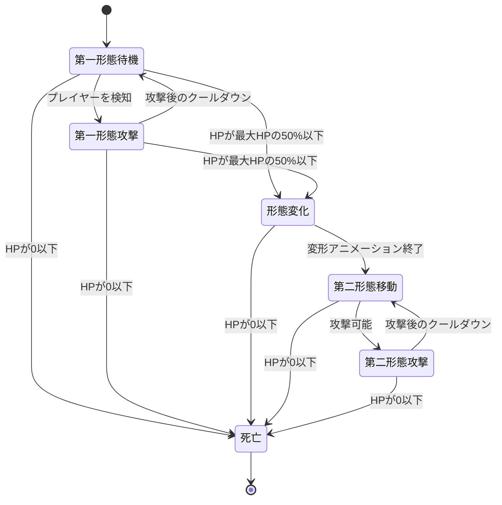

# 概要

## 基本情報

- **要素名（発音カタカナ）**：フォニアス
- **要素名（内部名・英文字）**：Phonias
- **分類**：モンスター（古代兵器型）
- **状態**：設計中
- **関連する設定・要素**：[[古代兵器]]、[[弾丸]]、[[接触ダメージ]]、[[モンスターAI]]、[[迷宮の遺跡]]

## コンセプト・世界設定

### 一言コンセプト

普段はその場から動かず、横方向や斜め方向へ謎の弾丸を発射する黒光りした人型古代兵器。HPが半分まで減ると封印されていた機構が起動し、腕を展開して浮遊移動を開始する。第二形態では本体への接触も危険になるが、攻撃方法自体は変化しない。

### 世界での由来・背景

フォニアスは、久遠の迷宮の古い遺跡に残された人型の自律兵器である。

その製造目的や本来の所有者は不明だが、現在も一定の条件に反応して外敵を排除する機能を維持している。生物のような食事や睡眠を必要とせず、長い年月を経ても遺跡内で稼働し続けている。

通常時のフォニアスは、腕を身体内部へ格納し、地面に立ったまま静止している。外見上はすでに機能を失った彫像や装飾品のようにも見える。しかし、プレイヤーを攻撃対象として認識すると、身体内部の機構が起動し、一定間隔で不可解な弾丸を発射する。

さらに、損傷が一定以上に達すると、制限されていた移動機構が作動する。腕が身体の外側へ展開され、顔にある矢印状の表示が青く発光する。この状態になるとフォニアスは浮遊し、自らプレイヤーへ接近するようになる。

この第二形態は、別の存在に変身した姿ではない。第一形態では使用されていなかった機能が解放された、本来の戦闘形態である。

### 生息地・出現条件

フォニアスは、古い遺跡や人工的な構造物が残る迷宮の部屋に出現する。

特に、整然とした石造りの部屋、古代の施設を思わせる回廊、機械的な装飾の残る固定マップに適している。ただし、出現条件を特定の部屋だけに限定せず、遺跡をテーマとしたランダムマップにも配置できるようにする。

フォニアスは通常時に移動しないため、部屋の中央や通路の奥など、プレイヤーが自然に発見できる場所に配置する。

出現段階は中盤後半を想定する。第一形態の弾丸を回避する能力に加えて、HPを半分まで削った後の行動変化にも対応する必要があるためである。

### 見た目・大きさ・色

フォニアスは、細身で均整の取れた人型ロボットである。

身体全体は黒色を基調とし、表面には強い光沢がある。単なる黒い影ではなく、光が当たった部分には細い反射線が現れ、金属製の装甲であることがわかる。

頭部は人間の頭に近い形状を持つが、髪、花、装飾的な頭飾りは存在しない。顔には目や口の代わりに矢印を思わせる記号状の表示が設けられている。この矢印はフォニアスが向いている方向や、起動状態を示す主要な視覚要素となる。

頭部の左右上方には、魔王の角を思わせる鋭い突起が生えている。ただし、実際の生物の角ではなく、頭部装甲と一体化した機械的な突起である。

第一形態では腕が身体内部に格納されており、胴体から腕が伸びているようには見えない。第二形態になると肩部と前腕部の装甲が展開され、両腕が外へ現れる。

第二形態では足が地面から離れ、身体全体が浮遊する。顔の矢印は鮮やかな青色に発光し、第一形態との違いが一目でわかるようになる。

#### 形態ごとの外見

| 部位・要素 | 第一形態 | 第二形態 |
| --- | --- | --- |
| 全体の色 | 黒色・黒光りする金属 | 黒色・黒光りする金属 |
| 顔の矢印 | 暗い灰色、または低輝度 | 明るい青色に発光 |
| 腕 | 身体内部に格納 | 左右の腕が展開 |
| 移動 | 位置を変えずに静止 | 浮遊して移動 |
| 身体接触 | プレイヤーにダメージを与えない | プレイヤーにダメージを与える |
| 攻撃方法 | 横方向・斜め方向への弾丸 | 同じ弾丸。弾速と発射間隔が強化される |

小さな画面でも形態変化が認識できるように、第二形態では矢印の発光、腕の展開、浮遊という三つの変化を組み合わせる。細部の装甲を増やすよりも、この三点を優先する。

### 性格・生態・用途

フォニアスは生物ではなく、あらかじめ設定された防衛行動を実行する自律兵器である。

通常時は、プレイヤーが近くを通過しても自ら接近しない。起動後は一定の射程内にいるプレイヤーへ弾丸を発射するが、身体を使った直接攻撃は行わない。

ただし、HPが半分まで減少すると、内部に格納されていた移動機構と腕が展開される。この状態ではプレイヤーへの接近を開始し、身体に接触した相手にもダメージを与える。

第二形態になっても、攻撃の種類は変わらない。追加の武器を取り出したり、新しい弾丸を使ったりするのではなく、同じ攻撃をより高い頻度と速度で行う。

この一貫性によって、プレイヤーは第一形態で覚えた弾丸の回避方法を第二形態でも利用できる。ただし、フォニアス自身が接近してくるため、同じ距離を保ち続けることは難しくなる。

### プレイヤーに伝えたい印象

第一形態では、古代遺跡に置かれた静かな機械が、突然攻撃を開始する不気味さを表現する。

HPを半分まで削ると、停止していた兵器が起動し、別の戦闘段階へ移行する。プレイヤーは単純に弾丸を回避するだけではなく、接近する本体との距離にも注意を払う必要がある。

フォニアスの脅威は、複雑な攻撃の種類や特殊能力の多さではなく、**静止した砲台から、接触も危険な移動型兵器へ変化すること**にある。

# 物語的設定

## 起源

フォニアスは、久遠の迷宮が現在の構造になる以前に作られた、古代の防衛兵器である。

製造者の名前や製造年代を示す記録は残っていない。残されているのは、遺跡の一角に固定された状態で稼働を続ける本体と、身体各部に刻まれた識別記号だけである。

本体の外装は黒く光り、金属でありながら継ぎ目が目立たない。これは長い年月の経過によって劣化したというよりも、もともと継ぎ目を外から確認できない構造であると考えられる。

フォニアスは、指定された場所を防衛するために設置された兵器だった可能性が高い。第一形態で移動しないのは、故障したからではなく、通常の防衛状態では移動機構を使用する必要がなかったためである。

## 第一形態：待機防衛機構

第一形態のフォニアスは、設置された場所から移動しない。

この状態では、身体内部に移動機構と腕が格納されている。頭部の矢印状表示も発光しておらず、黒い装甲の一部として見える。

しかし、内部の攻撃機構は稼働している。プレイヤーを攻撃対象として認識すると、身体を動かさずに弾丸を発射する。

第一形態で接触してもダメージを受けないのは、身体の外側に攻撃用の機構が露出していないためである。表面そのものに攻撃性があるわけではなく、危険なのは発射される弾丸だけとなる。

この状態は、フォニアスが本来想定していた防衛段階であり、敵が接近してきたときに初めて移動機構を使用するという設計だったと考えられる。

## 第二形態：戦闘機構の解放

フォニアスのHPが半分まで減少すると、通常の防衛機構だけでは対象を排除できないと判断し、制限されていた戦闘機構を解放する。

頭部の矢印が青く発光し、肩部と前腕部の装甲が展開される。格納されていた腕が外へ現れ、身体を支えていた脚部は地面から離れて浮遊状態になる。

第二形態では、フォニアスはプレイヤーを追跡する。第一形態のように一か所にとどまって攻撃を続けることはなく、距離を詰めながら同じ弾丸を発射する。

この変化によって、プレイヤーは弾丸を避けるだけでなく、フォニアスの本体との衝突にも注意しなければならなくなる。

第二形態への移行は、一時的な強化や回復ではない。フォニアスが本来備えていた機能を解放することによる、恒久的な形態変化である。

## 顔の矢印の意味

フォニアスの顔にある矢印状の表示は、目や口の代わりとなる機械的な識別表示である。

第一形態では発光しておらず、暗い装甲の一部として見える。第二形態では青く光り、戦闘機構が解放された状態を示す。

矢印は攻撃時の照準方向を補助する表示でもあり、フォニアスが攻撃対象を認識していることを示す。ただし、矢印そのものが弾丸を発射したり、特殊効果を発生させたりするわけではない。

この表示によって、目や口がない機械的な顔でも、起動状態の変化をプレイヤーに伝えられる。

## 迷宮との関係

フォニアスは、迷宮内の古い施設や遺跡を防衛するために設置された兵器である。

迷宮が変化しても、自らの設置場所を防衛するという基本的な行動原理は維持されている。ただし、第二形態では移動機構が解放されるため、設置場所だけにとどまらず、攻撃対象を追跡できるようになる。

フォニアスの存在する部屋は、単純な通路というよりも、かつて重要な施設や区域を守っていた場所として設定できる。

## 他のモンスターとの関係

### 近接攻撃型モンスターとの関係

フォニアスは、第一形態では固定位置から弾丸を発射し、第二形態では移動しながら同じ攻撃を行う。

そのため、近接攻撃型モンスターと同じ部屋に配置すると、プレイヤーは接近してくる敵を避けながら、フォニアスの弾丸にも対処する必要がある。

ただし、第一形態のフォニアスは本体に接触してもダメージを与えないため、プレイヤーが直接接近すること自体は可能である。第二形態になると本体にも接触ダメージが発生するため、同じ距離で戦い続けることが難しくなる。

初回遭遇では単独で配置し、形態変化を理解した後に近接攻撃型モンスターとの組み合わせを使用する。

# ゲーム内での役割

## プレイヤーが遭遇する状況

フォニアスは、古代の施設や遺跡をテーマとした部屋で遭遇する。

第一形態では部屋の中に静止しているため、プレイヤーは最初、動かない装飾やオブジェクトの一部だと認識する可能性がある。接近するか攻撃範囲に入ると弾丸を発射し、敵としての活動を開始する。

戦闘を進めてHPを半分まで削ると、第二形態へ移行する。腕が展開され、顔が青く発光し、浮遊移動を開始することで、戦闘が次の段階に進んだことがわかる。

## ゲームプレイ上の役割

フォニアスは、固定砲台から移動型の戦闘兵器へ変化する、中耐久の強敵である。

第一形態では位置が固定されているため、プレイヤーは弾丸の方向と発射タイミングを見極めながら接近できる。身体に接触してもダメージを受けないため、接近すること自体に追加の危険はない。

しかし、HPを半分まで削ると第二形態に移行し、フォニアス自身がプレイヤーへ接近するようになる。このときから本体への接触もダメージの原因となるため、プレイヤーは距離を保ちながら攻撃する必要がある。

攻撃方法は変わらないため、新しい攻撃のパターンを大量に覚える必要はない。既存の弾丸に対する回避技術を、移動する敵に対して利用することが求められる。

## プレイヤーに促す判断・行動

第一形態では、弾丸の進行方向を見て、横方向または斜め方向への射線から外れることが重要になる。フォニアスは移動しないため、プレイヤーは攻撃のタイミングを観察しながら接近できる。

第二形態では、弾丸だけでなく本体の接近にも注意する必要がある。密着状態を維持すると接触ダメージを受けるため、攻撃の合間に距離を取り直すことが有効となる。

また、第二形態に移行しても、弾丸の種類そのものは変わらない。第一形態で攻撃の方向や回避方法を理解したプレイヤーほど、第二形態でも有利に戦える。

## 他のモンスターとの違い

フォニアスは、二つの形態を持つことが最大の特徴である。

通常の移動型モンスターは、プレイヤーを発見すると追跡して攻撃する。一方、フォニアスは第一形態では固定位置から弾丸を撃つだけであり、HPが半分になると初めて移動能力を解放する。

また、形態変化後も攻撃の種類を増やさないことで、戦闘の中心はあくまで弾丸の回避と距離管理に保たれる。

## 想定する難易度・進行段階

**出現段階：中盤後半。**

第一形態だけなら攻撃方向を見極めて対処できるが、第二形態では接触ダメージと追跡によって立ち回りが変化するため、通常の敵よりも高い判断力を要求する。

初回遭遇では単独で配置し、HP半減による形態変化を十分に観察できるようにする。慣れた後は、近接攻撃型モンスターと組み合わせる。ただし、第一形態の時点で複数の敵から同時に攻撃される構成は避ける。

# プレイヤーから見える仕様

## 第一形態：固定攻撃

第一形態のフォニアスは、初期配置された位置から移動しない。

プレイヤーを攻撃対象として認識すると、身体の向きを変えて照準を合わせ、横方向または斜め方向へ弾丸を発射する。攻撃のために身体を移動させることはない。

弾丸は発射された時点で進行方向が決まり、その後は直線的に移動する。プレイヤーの移動に合わせて追尾したり、途中で軌道を変更したりすることはない。

### 攻撃仕様

| 項目 | 値・範囲 | 補足 |
| --- | --- | --- |
| 攻撃種別 | 直線弾の発射 | 横方向・斜め方向のみ |
| 発射間隔 | 2.8秒 | 次の弾丸を発射するまで |
| 弾速 | ゴブリンの移動速度の1.2倍を初期案とする | 直線的に移動 |
| 攻撃力 | ゴブリンの通常攻撃0.7回分相当 | 弾丸1発あたり |
| 射程 | 画面内の攻撃可能範囲 | 壁などの障害物を考慮 |
| 追尾 | なし | 発射後に方向を変更しない |
| 同時発射数 | 1発 | 扇状の多弾攻撃は行わない |
| 本体接触ダメージ | 0 | 第一形態では接触してもダメージを受けない |

弾丸は、横方向の左右と、斜め方向の四方向を基本とする。真上や真下へ向かう垂直弾は発射しない。

攻撃方向は、発射時点のプレイヤーの位置をもとに選択する。発射後はプレイヤーの移動に追従せず、一定の方向へ飛び続ける。

### 弾丸の外見

弾丸は、古代のエネルギー兵器を思わせる、小型の光弾とする。

中心は暗い色で、外周に淡い白色や灰色の縁取りを設ける。フォニアスの身体が黒いため、弾丸まで完全な黒色にすると背景に紛れて見えにくくなる。そのため、弾丸には明るい輪郭を持たせ、危険な飛翔物として識別できるようにする。

弾丸の正体や属性は、設定上も未解明とする。炎、毒、魔法などの特定の属性を持つものではなく、古代兵器から発射される正体不明の攻撃弾として扱う。

## 第二形態：移動戦闘

フォニアスのHPが最大HPの50%以下になると、第二形態への移行が始まる。

移行時には、頭部の矢印が青色に発光し、腕が身体の外側へ展開する。その後、脚部が地面から離れて浮遊し、プレイヤーへの追跡を開始する。

第二形態では、フォニアスの移動速度はゴブリンの0.65倍を初期案とする。プレイヤーへ向かってゆっくりと移動するが、高速で突進する能力は持たない。

攻撃方法は第一形態と同じであり、横方向または斜め方向へ弾丸を発射する。ただし、弾丸の速度は第一形態より速くなり、発射間隔もわずかに短くなる。

### 第二形態の攻撃仕様

| 項目 | 値・範囲 | 補足 |
| --- | --- | --- |
| 移動速度 | ゴブリンの0.65倍 | プレイヤーを追跡する |
| 発射間隔 | 2.4秒 | 第一形態より短い |
| 弾速 | ゴブリンの移動速度の1.45倍 | 第一形態の約1.2倍 |
| 攻撃力 | ゴブリンの通常攻撃0.7回分相当 | 弾丸1発あたり。威力は変更しない |
| 攻撃方向 | 横方向・斜め方向 | 第一形態と同じ |
| 追尾 | なし | 発射後の軌道は固定 |
| 本体接触ダメージ | ゴブリンの通常攻撃0.6回分相当 | 接触中に連続して発生しないよう制御 |

第二形態では弾丸の速度と発射頻度が上がるが、攻撃そのものは変わらない。プレイヤーが第一形態で学んだ回避方法を引き続き使えるようにする。

## 形態変化の条件

形態変化の条件は、HPが最大HPの50%以下になることである。

条件を満たした時点で第二形態への移行を一度だけ開始する。形態変化によってHPは回復せず、残りHPをそのまま引き継ぐ。

例えば、フォニアスのHPが最大HPの60%から一度の攻撃で40%まで減少した場合、その時点で第二形態へ移行する。HPを必ず50%に固定する処理は行わない。

形態変化中は、攻撃を0.8秒間停止する。腕の展開、矢印の発光、浮遊開始を順番に見せるための時間であり、変化が完了すると第二形態の攻撃を再開する。

変形中も本体はダメージを受ける。ただし、第一形態の接触ダメージは変形が完了するまで無効とし、第二形態の接触ダメージは変形完了後に有効化する。

## プレイヤーから見える予兆

第一形態では、弾丸を発射する直前に顔の矢印が照準方向へ向き、身体内部に小さな発光が生じる。

第二形態への移行時には、矢印の青い発光、腕の展開、身体の浮遊が起こる。この変化によって、プレイヤーは接触ダメージが発生する状態になったことを判断できる。

また、第二形態では弾丸の速度と発射間隔が変化するため、第一形態と同じタイミングだけで回避しようとすると被弾する可能性がある。

## 接触ダメージ

第一形態では、プレイヤーがフォニアス本体に接触してもダメージを受けない。

第二形態では、身体全体に接触ダメージ判定を設ける。ダメージは0.6秒間隔で最大1回発生するようにし、接触している間に毎フレームダメージが発生することを防ぐ。

接触ダメージは、第二形態の移動によって自然に発生する危険として扱う。専用の体当たり攻撃や突進攻撃は追加せず、弾丸と接触の二つだけでプレイヤーに圧力を与える。

## 撃破時の結果

フォニアスは、HPが0以下になった時点で撃破される。

第一形態で撃破された場合は、腕を格納したまま機能を停止し、黒い装甲の光沢が失われるような演出を行う。

第二形態で撃破された場合は、腕を展開した姿勢のまま浮遊が停止し、頭部の青い矢印が消灯して落下するように消滅する。

固有ドロップは現時点では設定しない。

# 数値・バランス

| 項目 | 値・範囲 | 補足 |
| --- | --- | --- |
| HP / 耐久度 | ゴブリン5体分相当 | 中程度よりやや高い耐久力 |
| 形態変化条件 | 最大HPの50%以下 | 一度だけ発動 |
| 第一形態の移動速度 | 0 | 配置位置から移動しない |
| 第二形態の移動速度 | ゴブリンの0.65倍 | 浮遊してプレイヤーを追跡 |
| 第一形態の攻撃力 | ゴブリンの通常攻撃0.7回分相当 | 弾丸1発あたり |
| 第二形態の攻撃力 | ゴブリンの通常攻撃0.7回分相当 | 威力は変更しない |
| 第一形態の発射間隔 | 2.8秒 | 単発弾 |
| 第二形態の発射間隔 | 2.4秒 | 少し高頻度になる |
| 第一形態の弾速 | ゴブリンの移動速度の1.2倍 | 直線弾 |
| 第二形態の弾速 | ゴブリンの移動速度の1.45倍 | 第一形態より速い |
| 第一形態の接触ダメージ | 0 | 接触しても無傷 |
| 第二形態の接触ダメージ | ゴブリンの通常攻撃0.6回分相当 | 0.6秒間隔で判定 |
| 形態変化の所要時間 | 0.8秒 | 攻撃を一時停止 |
| 攻撃方向 | 横・斜め | 垂直方向への弾丸は発射しない |
| 想定出現段階 | 中盤後半 | 遺跡などに出現 |
| 固有ドロップ | なし | 現時点では未設定 |

※数値は調整用の初期案。ゴブリンの実際のHP、攻撃力、移動速度が決まった段階で比較基準を統一する。

# 実装仕様（Unity）

## 挙動の流れ

### 1. 生成・待機

フォニアスがマップに生成された時点で、HP、攻撃タイマー、形態状態を初期化する。

第一形態では移動処理を無効にし、生成時の位置から移動しない。通常のエネミーAIとは異なり、プレイヤーを追跡する移動処理を実行する必要はない。

### 2. プレイヤーの検知

プレイヤーが攻撃範囲内に入ると、フォニアスはプレイヤーの位置を取得し、攻撃方向を決定する。

攻撃方向は、横方向または斜め方向のいずれかを選択する。発射時点で方向を確定し、弾丸の発射後に目標位置を更新することはしない。

### 3. 第一形態の攻撃

攻撃タイマーが0以下になった場合、フォニアスは弾丸を1発生成する。

弾丸は確定した方向へ直線移動し、プレイヤーや障害物への接触によって既存の弾丸処理に従う。

弾丸を発射した後は、2.8秒のクールダウンを開始する。第一形態では移動処理と接触ダメージを無効にしたまま、攻撃を続ける。

### 4. HP半減の検知

ダメージ処理後にHPを確認し、現在HPが最大HPの50%以下で、まだ第二形態へ移行していない場合は形態変化を開始する。

形態変化のフラグを設定し、攻撃処理を停止する。これにより、複数回のダメージ判定が発生しても、形態変化が何度も実行されないようにする。

### 5. 第二形態への移行

形態変化中は0.8秒のタイマーを開始する。

この間に頭部の矢印を青く発光させ、腕の展開アニメーションを再生する。アニメーションが終了した時点で浮遊移動を開始し、接触ダメージ判定を有効化する。

HPは形態変化開始時の値を引き継ぎ、回復させない。

### 6. 第二形態の移動

第二形態では、通常のエネミーAIによる追跡処理を有効にする。

フォニアスはプレイヤーの位置を取得し、通行可能な経路を使ってゆっくり接近する。移動中も攻撃タイマーを管理し、攻撃可能な状態であれば弾丸を発射する。

第二形態では、発射間隔を2.4秒、弾速をゴブリンの移動速度の1.45倍に変更する。攻撃方向や弾丸の種類は第一形態と同じものを使用する。

### 7. 接触ダメージ

第二形態の接触ダメージは、プレイヤーとフォニアスの接触判定によって発生する。

接触している間は0.6秒間隔でダメージ判定を行い、毎フレームダメージが発生しないようにする。

第一形態ではこの処理を無効にする。形態変化中も無効のままにし、第二形態への移行が完了した時点で有効化する。

### 8. 死亡

HPが0以下になった場合は、現在の形態にかかわらず死亡状態へ移行する。

死亡状態では攻撃、追跡、接触ダメージ、形態変化の処理を停止する。生成済みの弾丸は、既存の敵弾処理に従って扱う。

死亡演出を再生し、通常のドロップ処理の後にフォニアスを削除する。

## 状態遷移

## 実装上の注意

### 形態の管理

第一形態と第二形態を、別々のモンスターとして生成し直す必要はない。ひとつのフォニアス本体でHPを維持し、形態に応じて移動、描画、攻撃頻度、接触ダメージの設定を切り替える。

形態変化時にHPが初期化されたり、ドロップ処理が二重に実行されたりしないようにする。

### 弾丸の方向

弾丸の方向は、横方向と斜め方向のみに限定する。攻撃方向を決定する処理では、プレイヤーとの位置関係から方向を選び、垂直方向への攻撃を除外する。

例えば、プレイヤーとの左右差が大きい場合は横方向へ、上下差が大きい場合は斜め方向へ発射する。プレイヤーがほぼ真上や真下にいる場合も、左右どちらかの斜め方向を選択する。

一度発射した弾丸は直線移動を維持し、途中でプレイヤーを追尾しない。

### 浮遊移動

第二形態では、足が地面から離れた状態を維持し、身体を上下に揺らすアニメーションを使用する。

浮遊アニメーションのためにコライダーを大きく上下させる必要はない。実際の移動と接触判定はXY平面で処理し、見た目だけを浮遊させる。

### 接触ダメージ

接触ダメージは、接触判定が連続している間に毎フレーム発生させてはならない。対象ごとにダメージ間隔を管理し、指定した時間が経過した場合にだけ次のダメージを発生させる。

また、第一形態、形態変化中、第二形態で接触ダメージの状態を明確に切り替える。特に形態変化の途中で接触ダメージが有効にならないようにする。

### 死亡処理

形態変化中や攻撃アニメーション中にHPが0以下になった場合は、死亡状態を優先する。

死亡したフォニアスから新しい弾丸が発射されたり、形態変化が完了して再び活動したりしないようにする。

# 演出・操作感

## アニメーション・見た目の変化

第一形態では、身体を完全に静止させる。顔の矢印は発光させず、黒い装甲の反射だけで形状を表現する。

攻撃直前には、顔の矢印が照準方向へ向き、身体内部に小さな光が現れる。弾丸の発射時には身体を大きく動かさず、最小限の機械的な動作だけで攻撃を表現する。

第二形態への移行では、頭部の矢印が青く光り、肩部と前腕部の装甲が開いて腕が展開する。続いて脚部が地面から離れ、身体が浮遊する。

第二形態の通常移動では、腕を少し開いた姿勢を維持し、移動に合わせて身体全体がゆっくりと揺れる。顔の青い発光は維持し、第一形態に戻ることはない。

## 効果音・BGM

第一形態では、弾丸の発射時に低い機械音を使用する。動かない兵器であることを強調するため、歩行音や浮遊音は鳴らさない。

形態変化時には、装甲が開く音、機械の駆動音、浮遊機構の起動音を順番に再生する。矢印の青い発光と同時に短い起動音を鳴らすことで、形態変化を聴覚的にも伝える。

第二形態では、低い浮遊音を加える。ただし、弾丸の発射音を聞き取りにくくしないようにする。

専用BGMは設けず、通常の部屋のBGMを使用する。

## エフェクト

第一形態の弾丸には、暗い中央と明るい輪郭を持つ小さなエフェクトを使用する。

第二形態では、弾丸の種類を変更せず、飛翔速度の変化によって攻撃の強化を表現する。

形態変化時には、顔の矢印に青い発光エフェクトを表示し、腕の展開に合わせて肩部と前腕部の継ぎ目を一瞬だけ明るくする。

## UI・ログ・説明文

専用のHPバーは設けず、通常の敵と同様にHPを管理する。

ただし、HPが半分になると形態が変化するため、変化がプレイヤーに伝わるようにする。顔の矢印が青く発光し、腕が展開する動作によって、攻撃が強化されたことと接触ダメージが発生する状態になったことを示す。

**図鑑説明文案**

「古代の遺跡に残された、人型の自律兵器。普段はその場から動かず、横方向や斜め方向へ正体不明の弾丸を発射する。損傷が一定以上に達すると封印された機構が起動し、腕を展開して浮遊移動を開始する。第二形態では本体との接触も危険になるため、弾丸だけでなく接近にも注意が必要となる。」

## 操作・フィードバック上の注意

形態変化によって接触ダメージが発生するようになるため、第二形態への移行は明確に伝える必要がある。

矢印の青い発光だけでは小さな画面で見逃される可能性があるため、腕の展開と浮遊開始も組み合わせる。

また、第二形態でも攻撃方法は変わらない。プレイヤーが新しい攻撃の種類を覚える必要はなく、第一形態で理解した弾丸の回避方法を引き続き使えるようにする。

# 例外・確認項目

## 同時発生・連続使用時

フォニアスが複数体出現した場合、それぞれの攻撃タイマーと形態変化の判定は独立して管理する。

ただし、複数体が同時に弾丸を発射すると回避できる空間が狭くなるため、初回遭遇では1体のみを配置する。

複数体を配置する場合は、発射タイミングが完全に重ならないように初期タイマーをずらす。第二形態への移行が複数体で同時に発生する部屋は、上級者向けの構成とする。

## 壁・段差・画面外など地形との関係

第一形態では、配置された位置から移動しない。プレイヤーやほかの敵の移動によって押し出されることもないようにする。

第二形態では、通常のエネミーAIと同様に通行可能な経路を利用して移動する。壁やバリケードを無視して移動したり、壁越しに本体接触ダメージを与えたりすることはない。

弾丸は壁を貫通しない。壁やバリケードに衝突した場合は、既存の弾丸処理に従って消滅させる。

奈落へ落ちる経路は選択せず、通行不能な地形に到達した場合は別の経路を探す。

## 死亡・ステージ移動・一時停止時

フォニアスが死亡した場合、形態変化と攻撃処理を即座に停止する。

ステージ移動時は、通常のモンスターと同様にフォニアスと生成済みの敵弾を破棄する。

一時停止中は、攻撃タイマー、形態変化のタイマー、移動処理、弾丸の移動を停止する。

## 他の効果との重複・競合

フォニアスは、現段階では特殊な状態異常や地形効果を持たない。

プレイヤーの盾や防具によるダメージ軽減は、既存の防御処理に従う。第二形態の接触ダメージも、通常の敵の接触ダメージと同様の計算方法を使用する。

## プレイヤーに誤解されそうな点

第一形態のフォニアスは動かないが、弾丸による攻撃は行う。静止していることは、無害であることを意味しない。

また、第一形態では身体に接触してもダメージを受けないが、第二形態では接触ダメージが発生する。この違いは形態変化の演出によって明確に示す。

第二形態は新しい攻撃を獲得する形態ではなく、移動能力と接触ダメージが解放され、既存の弾丸攻撃が強化された形態である。

# 関連記事・参考ページ

## 関連するObsidian記事

- [[古代兵器]]：フォニアスの分類と、遺跡に残された自律兵器の設定。
- [[弾丸]]：横方向・斜め方向への直線弾の共通処理。
- [[接触ダメージ]]：第二形態で有効化する本体接触のダメージ判定。
- [[モンスターAI]]：第二形態の追跡と経路探索。
- [[迷宮の遺跡]]：主な出現環境。

※上記は関連資料を整理するための候補記事であり、実際に存在する記事を示すものではない。

## 参考資料

- [久遠の迷宮・モンスター募集作品](https://scratch.mit.edu/projects/1382505113)
  - 応募されたモンスターの原案を確認するための参照先。

- [久遠の迷宮・Scratch版](https://scratch.mit.edu/projects/1169722485/)
  - 元となるゲームの参照先。

## 作業メモ

### 未決定事項

- **弾丸の外見**：暗い中央と明るい輪郭を持つ光弾を初期案とする。ドット絵での視認性を確認して決定する。
- **弾丸の攻撃力**：ゴブリンの通常攻撃0.7回分相当を初期案とする。
- **形態変化時のアニメーション**：腕の展開と矢印の発光を中心に作成する。
- **第二形態の接触ダメージ**：ゴブリンの通常攻撃0.6回分相当を初期案とする。
- **固有ドロップ**：現時点では設定しない。

### 実装・調整タスク

1. 黒光りする人型ロボットのスプライトを作成する。
2. 第一形態用の腕を格納したスプライトと、第二形態用の腕を展開したスプライトを作成する。
3. 横方向・斜め方向に発射する直線弾を実装する。
4. HPが最大HPの50%以下になったときの形態変化を実装する。
5. 形態変化後の浮遊移動と追跡を実装する。
6. 第二形態の弾速と発射間隔を変更する。
7. 第二形態だけ本体接触ダメージを有効化する。
8. 形態変化中に撃破された場合、攻撃や変形が継続しないことを確認する。

### 確認方法

第一形態では、フォニアスが配置位置から動かず、横方向と斜め方向に弾丸を発射することを確認する。本体に接触してもダメージを受けず、弾丸に当たったときだけダメージを受けることも確認する。

次に、HPを半分まで削り、矢印の青い発光、腕の展開、浮遊開始が順番に発生することを確認する。

第二形態では、フォニアスがプレイヤーを追跡し、本体への接触でダメージが発生することを確認する。弾丸の攻撃方向は第一形態と同じまま、発射間隔と弾速だけが強化されていることも確認する。

最後に、第二形態へ移行した際にHPが回復しないこと、形態変化が複数回発動しないこと、死亡時に移動や攻撃が正しく終了することを確認する。

- **関連ファイルへのリンク**：[[古代兵器]]、[[弾丸]]、[[接触ダメージ]]、[[モンスターAI]]
- **更新日**：2026-10-18