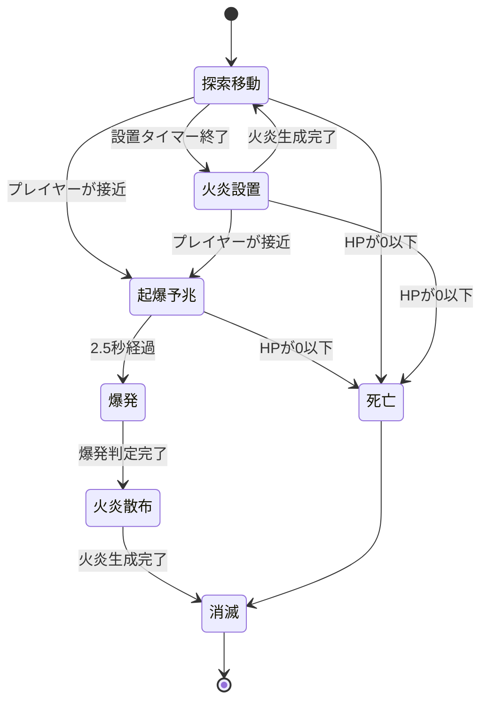

# 概要

## 基本情報

- **要素名（発音カタカナ）**：フレイミー
- **要素名（内部名・英文字）**：Flamey
- **語源**：英語の Flame（炎）をもとにした創作名
- **分類**：モンスター
- **状態**：設計中
- **関連する設定・要素**：[[マグマ]]、[[炎上地形]]、[[爆発判定]]、[[火炎ギミック]]、

## コンセプト・世界設定

### 一言コンセプト

黒い爆弾状の身体で移動し、上部の炎を本体とする爆発性の魔物。移動中に地面へ火を残し、接近した相手には数秒後に爆発する攻撃を仕掛ける。爆発後には周囲へ火を撒き散らし、戦闘場所そのものを危険な地形へ変える。

### 世界での由来・背景

フレイミーは、久遠の迷宮の高温領域に生息する、炎と爆弾が一体化したような魔物である。

その身体は、上部の炎と下部の黒い爆弾状の器官から構成されている。炎の部分がフレイミーの本体であり、意思や生命活動の中心となっている。一方、黒い部分は移動と爆発を担う器官であり、炎を運ぶとともに、蓄積した熱と魔力を一度に放出する役割を持つ。

フレイミーは自分の身体に蓄えた熱を周囲へ放出できる。この性質によって、移動した場所に火を残したり、身体全体を爆発させたりすることができる。

ただし、爆発は無制限に繰り返せる能力ではない。黒い器官に蓄積したエネルギーを使い切ると、身体を維持できなくなる。そのため、最大規模の爆発を起こしたフレイミーは消滅し、残された炎だけが一時的に地面へ燃え移る。

### 生息地・出現条件

フレイミーは、マグマ地帯、火山性の迷宮、溶岩の流れる回廊など、高温環境を中心に出現する。

特に適しているのは、マグマの池や狭い通路が組み合わさった部屋である。プレイヤーがマグマを避けながら進む場所にフレイミーが出現すると、時間差爆発と火炎の残留によって、安全に移動できる場所が変化する。

通常の部屋への出現は可能だが、火炎を残す能力によって部屋が長時間危険になりすぎないよう、基本的には火属性の環境に配置する。

出現段階は中盤を想定する。単純に攻撃を避けるだけではなく、爆発の予兆を見て退避し、爆発後の火を避けて移動する必要があるため、地形への対処に慣れたプレイヤー向けの敵とする。

### 見た目・大きさ・色

フレイミーの外見は、黒い爆弾の上に炎が乗ったような構造である。

上部には橙色から黄色にかけての炎が存在し、輪郭は不規則に揺れている。炎の中心には白に近い黄色を配置し、外側へ向かうほど橙色や赤色へ変化させる。炎は独立した存在として見えるように描き、単なる装飾や頭部の髪のように見えないようにする。

下部には、丸みのある黒い爆弾状の身体を配置する。表面は暗い灰色から黒色で、中央付近に小さな継ぎ目や金属部品を設ける。足は持たせず、下部の爆弾部分が上下に揺れながら地面を移動する。

上部の炎は本体であるため、下部の身体の動きに追従しつつ、独立して揺らめくアニメーションを持たせる。爆発が近づくと炎が大きくなり、明滅の頻度が上がる。

色の役割は次のように整理する。

| 部位 | 色 | 視覚的な役割 |
| --- | --- | --- |
| 炎の中心 | 明るい黄色 | 本体の存在とエネルギーを示す |
| 炎の外側 | 橙色・赤色 | 炎らしさと熱の印象を強める |
| 爆弾状の身体 | 黒色・暗い灰色 | 爆発物を連想させる |
| 起爆部分 | 赤橙色 | 爆発が近いことを示す |
| 地面に残る火 | 橙色・黄色 | 接触すると危険な場所を示す |

2D見下ろし型の小さな画面では、炎と黒い爆弾のコントラストを最優先にする。小さな金属部品や模様を増やしすぎず、炎のシルエットだけでも識別できるようにする。

### 性格・生態・用途

フレイミーは、周囲を移動しながら熱を撒き散らす性質を持つ。ほかのモンスターのように直接的な接近攻撃だけを繰り返すのではなく、地面に火を残すことで移動経路を制限する。

プレイヤーを発見すると、接近して自爆攻撃の準備に入る。準備中は身体を停止させ、上部の炎と黒い爆弾部分を激しく明滅させる。一定時間が経過すると爆発し、周辺に火を撒き散らす。

爆発はフレイミー自身にとっても身体を維持できなくなる行為である。爆発後、フレイミーは消滅するが、周囲には一定時間燃え続ける火が残る。

また、通常移動中にも、ときどき地面へ小さな火を落とす。この能力によって、プレイヤーはフレイミーがいる部屋で長く立ち止まりにくくなる。

### プレイヤーに伝えたい印象

「放置すると足場が危険になり、近づくと爆発するが、予兆を見れば対処できる敵」。

フレイミーの危険性は、単発の攻撃力だけではない。時間差爆発によってプレイヤーを移動させ、爆発後の火によって次の移動先まで制限するところにある。

一方、攻撃の前には明確な予兆があり、本体の耐久力も極端に高くしない。プレイヤーが挙動を理解すれば、爆発する前に撃破する、距離を取って爆発を誘導する、炎が消えるまで別の場所へ移動する、といった対処ができる。

# 物語的設定

## 起源

フレイミーは、久遠の迷宮の高温領域で、炎の魔力と爆発性の鉱物が結びついて生まれた魔物である。

上部の炎は単なる燃焼現象ではなく、フレイミー自身の生命活動を担う本体である。周囲の熱を取り込みながら燃え続け、黒い爆弾状の器官へエネルギーを送り込んでいる。

黒い器官は、炎を移動させるための身体であると同時に、熱と魔力を蓄積する容器でもある。器官の内部に一定量以上のエネルギーが蓄積すると、フレイミーはそれを放出しようとする。その放出が、ゲーム内で見られる爆発に相当する。

フレイミーは爆発によって周囲を焼き払うが、その代償として身体を失う。爆発後に残る火は、炎の本体が消滅する際に周囲へ放出された熱が、地面に残ったものとされる。

## 身体構造

### 上部の炎

上部の炎は、フレイミーの本体である。意識と生命活動の中心であり、下部の爆弾状の身体を制御している。

通常時は小さく安定した炎を保っているが、攻撃を準備すると熱量が増加し、炎が大きく揺れ始める。爆発直前には炎の中心が明るくなり、周囲に熱を放出する。

炎が存在する限りフレイミーは活動を続けることができるが、爆発時にはその生命活動も周囲へ放出されるため、通常の爆発後に再び元の姿へ戻ることはない。

### 下部の黒い爆弾

下部の黒い部分は、フレイミーの移動と爆発を担う器官である。

見た目は爆弾に近く、丸みのある黒い外殻を持つ。足は存在せず、外殻を傾けたり、小刻みに揺らしたりすることで移動する。

この器官は、炎の本体を地面から離れすぎない高さに保持しつつ、熱の蓄積と放出を行う。移動中にはわずかに振動し、爆発の準備に入ると激しく揺れ始める。

## 火を撒く性質

フレイミーは移動中、下部の器官から熱を含んだ火の粒子を地面へ落とすことがある。

落ちた火は、地面に小さな火炎領域を形成する。この領域は永久に残るものではなく、熱源を失うと数秒で消滅する。

この性質は、フレイミーが意図的に地面を燃やしているというよりも、身体から漏れ出した熱が周囲の可燃物や魔力を燃焼させる現象として説明できる。

## 爆発の仕組み

フレイミーの爆発は、黒い器官に蓄積されたエネルギーを一度に放出する現象である。

爆発の直前には、内部に蓄積された熱が外部へ漏れ出し、炎が明るくなる。一定時間後、外殻がエネルギーを保持できなくなると、内部の熱と魔力が周囲へ放出される。

爆発地点の周囲には、放出された炎が複数の小さな火炎領域を形成する。このため、爆発を回避したとしても、爆発後すぐに同じ場所へ戻ることは危険である。

### [[マグマ]]

マグマは、接触すると大きなダメージを受ける危険地形である。フレイミーの火は、マグマとは異なり、時間経過によって消滅する一時的な危険領域として扱う。

マグマ地帯にフレイミーを配置する場合、既存のマグマとフレイミーの火が視覚的に混同されないよう、マグマは暗い赤色の地面、フレイミーの火は明るい橙色の炎として区別する。

## 進化

現時点では進化形態を設定しない。

将来、上位種を追加する場合は、HPや爆発のダメージを単純に増加させるよりも、爆発範囲、火の設置方法、起爆までの時間などを変化させる方向が適している。

## 迷宮との関係

フレイミーは、久遠の迷宮の高温領域に生息する。マグマの池や溶岩の流れる回廊は、フレイミーの熱を維持しやすい環境である。

フレイミーが活動した場所には一時的な火炎領域が残るため、同じ部屋でも戦闘が進行するにつれて通行可能な場所が変化する。

この性質を利用し、フレイミーを単独の敵として配置するだけでなく、部屋の形状やマグマの配置と組み合わせることで、部屋そのものを戦闘ギミックとして機能させる。

# ゲーム内での役割

## プレイヤーが遭遇・入手する状況

フレイミーは、主にマグマ地帯や火山性の部屋で遭遇する。通常時は部屋の中を移動し、ときどき足元に火を残す。

プレイヤーが接近すると、フレイミーは爆発攻撃の準備に入る。爆発までには一定の猶予時間があり、予兆を見て離れるか、爆発前に撃破することができる。

## ゲームプレイ上の役割

フレイミーは、時間差爆発と一時的な火炎領域によって、プレイヤーの移動経路を制限する敵である。

単純にプレイヤーを追跡して攻撃するのではなく、火を設置して安全な場所を減らし、爆発によって広い範囲を一時的に危険にする。

ただし、火炎領域は一定時間で消える。プレイヤーは危険な場所を覚え続ける必要はなく、一時的に退避したり、火が消えた後に通過したりすることで対処できる。

## プレイヤーに促す判断・行動

フレイミーと戦う際、プレイヤーには三つの選択肢がある。

第一に、爆発の予兆が始まる前に接近して攻撃し、フレイミーが爆発する前に撃破する。

第二に、爆発の準備に入ったフレイミーから距離を取り、爆発を安全な位置で発生させる。その後、地面に残った火が消えるまで別の経路を通る。

第三に、フレイミーが残す火の位置を観察し、火のない場所へ移動しながら戦闘を続ける。

いずれも有効な対処方法であり、単一の行動だけが正解になる設計にはしない。

## 他のモンスターとの違い

フレイミーの特徴は、攻撃そのものよりも、攻撃後に残る危険領域にある。

[[リアファニス]]は、姿を隠して接近することでプレイヤーを奇襲する。[[ポイズ]]は、遠距離から状態異常を与える。これらに対して、フレイミーは爆発と火の設置によって、プレイヤーが移動できる場所を制限する。

また、通常の火炎攻撃を行う敵とは異なり、フレイミー自身が爆発して消滅するという性質を持つ。そのため、撃破のタイミングと爆発を誘導する位置が重要になる。

## 想定する難易度・進行段階

**出現段階：中盤。**

マグマ地帯に登場する敵として適している。爆発の予兆、爆発範囲、火の残留時間を理解していないプレイヤーには危険だが、攻撃の仕組みを理解すれば回避や早期撃破によって対処できる。

初回遭遇ではフレイミーを1体だけ配置し、火の設置と爆発後の炎を観察できるようにする。慣れた後は、通常の近接型モンスターと組み合わせる。

複数体を配置する場合は、爆発予兆が同時に発生し続けないように出現数と攻撃開始条件を調整する。

# プレイヤーから見える仕様

## 通常時の挙動

フレイミーは、下部の黒い爆弾状の器官を動かしてマップ内を移動する。上部の炎は移動に追従しながら揺らめき、常に燃焼している。

移動中は一定間隔で地面に火を残すことがある。この火は小さな円形の領域を形成し、一定時間が経過すると消滅する。

プレイヤーを発見すると距離を詰め、爆発攻撃の準備に入る。準備中は移動を停止し、身体の明滅によって起爆が近いことを知らせる。

## 攻撃方法：時間差爆発

フレイミーは、自爆を攻撃として利用する。

プレイヤーが一定距離以内に入ると、フレイミーは起爆動作に移行する。下部の黒い器官が激しく振動し、上部の炎が急速に明るくなる。起爆動作の開始から2.5秒後、フレイミーは爆発する。

爆発時には周囲へダメージを与え、さらに爆心付近へ複数の小さな火炎領域を発生させる。フレイミー本体は爆発と同時に消滅する。

この仕様により、プレイヤーは起爆動作を確認した後、逃げるか撃破するかを判断できる。

### 爆発仕様

| 項目 | 値・範囲 | 補足 |
| --- | --- | --- |
| 起爆開始距離 | プレイヤーとの距離が約2体幅以内 | 体幅を基準に判定 |
| 起爆予兆時間 | 2.5秒 | 予兆中は移動を停止 |
| 爆発範囲 | 半径約1.5体幅 | 爆心から円形に判定 |
| 爆発ダメージ | ゴブリンの通常攻撃1.2回分相当 | 初期提案値 |
| 爆発後の火炎領域 | 6～8個 | 通行可能な地面にのみ生成 |
| 火炎領域の持続時間 | 3秒 | 時間経過で消滅 |
| 自爆後の状態 | 本体消滅 | 通常の死亡・撃破処理へ移行 |

爆発のダメージは初期提案値であり、プレイヤーのHPや防具、盾による軽減と合わせて調整する。

### 地面への火の設置

フレイミーは、通常移動中にもときどき火を地面へ落とす。

設置間隔は5～7秒程度を初期案とし、設置された火は4秒間持続する。火の範囲は小さく、見下ろし型の画面で視認できる程度にする。

地面の火は、プレイヤーやモンスターが触れるとダメージを与える。火炎領域同士が重なっても、ダメージが重複して瞬間的に増加する仕様にはしない。

この能力は、爆発が起こる前から安全な移動経路を少しずつ減らすためのものである。

### 火炎領域の仕様

| 項目 | 値・範囲 | 補足 |
| --- | --- | --- |
| 設置間隔 | 5～7秒 | 通常移動中の追加行動 |
| 通常火炎の持続時間 | 4秒 | 時間経過で消滅 |
| 通常火炎の範囲 | 半径約0.35体幅 | 小範囲 |
| 爆発後の火炎の数 | 6～8個 | 爆心周辺へ生成 |
| 爆発後の火炎の持続時間 | 3秒 | 通常火炎より短い |
| 接触時のダメージ | ゴブリンの通常攻撃0.2回分相当 | 1秒間隔で判定 |
| ダメージの重複 | 同じ対象への同時重複なし | 火炎領域が重なってもダメージを増やさない |

火炎領域は永久に残らないため、戦闘後に部屋が通行不能になることはない。また、火炎領域ごとに独立したTilemapを追加する必要はなく、既存の火炎判定を再利用する。

## 発動条件・操作方法

フレイミーの攻撃は自動で発動する。プレイヤー専用の操作は必要ない。

プレイヤー側は通常の移動と剣、盾を用いて対応する。起爆予兆中はフレイミーを攻撃して撃破するか、爆発範囲外へ移動する。

爆発を回避できたとしても、その後に火が残るため、すぐに爆心へ戻ることは危険である。火が消えるまで迂回するか、周囲の安全を確認してから進む必要がある。

## 発動前の予兆・表示

起爆開始時には、次の変化を順番に表示する。

1. 下部の黒い器官が停止し、小さく震え始める。
2. 上部の炎が通常より明るくなり、明滅の頻度が上がる。
3. 爆心付近の地面に、薄い円形の予告エフェクトを表示する。
4. 爆発直前には短い警告音を鳴らす。
5. 起爆から2.5秒後に爆発する。

予告エフェクトは実際の爆発範囲と一致させる。装飾用の円とダメージ判定の範囲が食い違わないようにし、画面を縮小した場合でも危険範囲が認識できるようにする。

## 効果時間・クールダウン

通常の火炎領域は4秒間持続し、爆発後に生成される火炎領域は3秒間持続する。

フレイミーは爆発すると消滅するため、爆発後の攻撃クールダウンは存在しない。爆発を開始した個体は、爆発が終了するまで別の攻撃を開始しない。

地面に設置した火炎領域は、時間経過により自動的に消滅する。水やマグマなど、既存の地形との特殊な相互作用は現段階では設けない。

## 解除・終了条件

フレイミーの起爆動作は、原則として開始後に中断しない。起爆開始後にプレイヤーが距離を取っても、2.5秒後には爆発が発生する。

ただし、起爆予兆中にフレイミーがプレイヤーの攻撃で撃破された場合は、爆発を中止して通常の撃破処理へ移行する。

爆発後は本体が消滅し、残された火炎領域のみが一定時間存在する。すべての火炎領域が消滅すると、部屋にはフレイミーによる追加の危険領域が残らなくなる。

## 失敗時・無効時の挙動

起爆範囲内にプレイヤーが存在しなくなった場合でも、起爆は中断せず予定どおり爆発する。そのため、プレイヤーはフレイミーを安全な場所へ誘導してから退避することができる。

壁やバリケードがある場合、爆発のダメージ判定は原則として遮蔽を考慮せず、円形範囲内の対象に適用する。これは爆発が衝撃と熱を放出する攻撃であるためである。ただし、壁の向こうへ火炎領域を生成することはしない。

火炎領域の生成予定位置が壁、奈落、通行不能な地形に重なる場合、その位置には火を生成しない。マグマの上にも火炎領域を重ねず、既存のマグマ判定を優先する。

## 撃破時・使用後・取得時の結果

フレイミーは、起爆前にプレイヤーの攻撃によって撃破された場合、通常のモンスターと同様に死亡する。

このとき、起爆予兆中であっても爆発は発生しない。通常の死亡エフェクトを再生し、火炎領域を追加生成せずに消滅する。

一方、起爆が完了するとフレイミー自身が爆発し、通常の撃破とは異なる爆発エフェクトを再生する。爆発のダメージ判定と火炎領域の生成が完了した後、本体を削除する。

固有ドロップは現時点では設定しない。

# 数値・バランス

| 項目 | 値・範囲 | 補足 |
| --- | --- | --- |
| HP / 耐久度 | ゴブリン0.8体分相当 | 低めの耐久力を想定 |
| 通常攻撃力 | なし | 通常の接触攻撃は行わない |
| 爆発ダメージ | ゴブリンの通常攻撃1.2回分相当 | 爆心から半径約1.5体幅 |
| 通常火炎のダメージ | ゴブリンの通常攻撃0.2回分相当 | 1秒間隔で判定 |
| 移動速度 | ゴブリンの0.7倍 | 黒い器官を使って移動 |
| 起爆開始距離 | プレイヤーとの距離が約2体幅以内 | 接近時に起爆 |
| 起爆予兆時間 | 2.5秒 | 回避または撃破の猶予 |
| 通常火炎の設置間隔 | 5～7秒 | 移動中に設置 |
| 通常火炎の持続時間 | 4秒 | 一時的な危険領域 |
| 爆発後の火炎の持続時間 | 3秒 | 爆心周辺に生成 |
| 同時出現数 | 1体を基本、慣れた部屋で2体 | 予兆の重複を避ける |
| 出現段階 | 中盤 | マグマ地帯を中心に出現 |
| 固有ドロップ | なし | 現時点では設定しない |

※数値は初期提案値。ゴブリンの実際の能力値やプレイヤーのHP、防具、盾の軽減率が確定した段階で調整する。

# 実装仕様（Unity）

## 挙動の流れ

### 1. 開始条件

フレイミーがマップに生成された際、HP、移動速度、通常火炎の設置タイマー、起爆状態を初期化する。

フレイミーは本体である炎と、移動を担う黒い器官を持つが、ゲーム上はひとつのモンスターとして扱う。炎と黒い器官の見た目を別々にアニメーションさせても、基本的なHPや死亡状態は共有する。

### 2. 通常移動

黒い器官を動かしてマップ内を移動する。上部の炎は黒い器官に追従しながら揺らめく。

移動中は通常のエネミーAIに従い、プレイヤーを探索する。一定間隔ごとに火炎領域を生成し、移動した場所に一時的な危険地形を残す。

### 3. 起爆開始

プレイヤーが一定距離以内に入ると、フレイミーは起爆状態へ移行する。

起爆状態では移動を停止し、2.5秒間のタイマーを開始する。炎の明滅、黒い器官の振動、地面の予告エフェクトによって爆発が近いことを伝える。

この状態では通常火炎の追加設置を停止する。火を増やし続けながら起爆予兆を表示すると、危険範囲が過密になるためである。

### 4. 起爆予兆中の被弾

起爆予兆中にプレイヤーの攻撃を受け、HPが0以下になった場合は死亡状態へ移行する。

死亡状態になった時点で起爆タイマーを停止し、爆発を中止する。通常の死亡エフェクトを再生してフレイミーを削除する。

### 5. 爆発

起爆タイマーが0以下になった場合、爆発状態へ移行する。

爆発の中心位置は、起爆開始時に記録したフレイミーの位置とする。爆発範囲内にいる対象へダメージ判定を行い、続いて爆発エフェクトを再生する。

爆発後は、通行可能な地面の周囲へ6～8個の火炎領域を生成する。生成位置は爆心を中心に分散させ、壁や奈落、マグマ上には生成しない。

### 6. 火炎領域の処理

火炎領域はフレイミー本体とは独立したオブジェクトとして存在する。通常火炎と爆発後の火炎は同じ基底処理を利用し、持続時間やダメージ量などの設定だけを変える。

火炎領域は生成時にタイマーを開始し、一定間隔で接触対象にダメージを与える。持続時間が終了したらエフェクトを消し、オブジェクトを破棄するか、オブジェクトプールへ戻す。

火炎領域そのものはTilemapの変更を必要としない。独立したオブジェクトとTrigger判定によって扱うことで、火炎用Tilemapを増やさずに管理できる。

### 7. 終了後の処理

爆発のダメージ判定、エフェクト再生、火炎領域の生成が完了したら、フレイミー本体を削除する。

火炎領域は本体から独立しているため、フレイミーが消滅しても設定された時間だけ残る。その後、すべての火炎領域が消滅した時点で、フレイミーによる追加の危険領域がなくなる。

## 状態遷移

## 実装上の注意

### 本体と移動器官の分離

上部の炎が本体であり、下部の黒い器官が移動を担うという原案を、見た目とアニメーションに反映する。

ただし、Unity上で炎と黒い器官を別々の敵として管理する必要はない。親となるフレイミー本体の下に2つのスプライトを配置し、それぞれの表示位置とアニメーションだけを制御する方法が適している。

衝突判定は本体全体を対象にする。小さな炎だけを攻撃対象にすると、見下ろし型の画面では攻撃を当てにくくなりやすいためである。

### 爆発判定

爆発のダメージ判定は、爆心位置と半径をもとに円形範囲で処理する。

Unityの `Physics2D.OverlapCircleAll` などを利用すれば、指定した円形領域に存在するCollider2Dを取得できる。実装ではプレイヤー、モンスター、地形などのLayerを適切に分け、ダメージ対象だけを判定する。

爆発ダメージは、ひとつの爆発につき対象ごとに1回だけ適用する。爆発処理が複数フレームにまたがっても、同じ対象へ重複してダメージを与えないようにする。

### 火炎領域の管理

通常火炎と爆発後の火炎は、同じ火炎領域の仕組みを利用する。設定値として持続時間、ダメージ間隔、ダメージ量、範囲を持たせることで、同じ処理を再利用できる。

また、複数の火炎領域に同時に触れた場合でも、ダメージが重複しないようにする。対象ごとに火炎ダメージのクールダウンを共有し、火炎領域の数が多いほど瞬間的なダメージが増える仕組みは避ける。

### 地形との関係

火炎領域は、既存のマグマ判定とは別の一時的な危険領域として扱う。

マグマ上に火炎領域を生成しないことで、既存のマグマダメージと火炎ダメージが重複することを防げる。壁や奈落などの通行不能な場所にも火炎領域を生成しない。

### 一時停止とステージ移動

ゲームが一時停止した場合は、起爆タイマー、火炎領域の持続時間、ダメージ間隔を停止する。

ステージ移動時は、フレイミー本体と火炎領域を通常のステージ移動処理に従って破棄する。別ステージへ移動した後に、前の部屋の火が残らないようにする。

# 演出・操作感

## アニメーション・見た目の変化

通常移動時は、黒い器官が左右に揺れながら進み、上部の炎が少し遅れて追従する。

火炎領域を設置する際には、黒い器官が一瞬沈み込み、足元に小さな火を落とす。プレイヤーが火の存在に気付けるよう、設置時には短い発光を加える。

起爆予兆中は、黒い器官の振動を強め、上部の炎を段階的に明るくする。爆発の直前には炎が一瞬だけ縮み、その直後に大きく広がるような動きを付ける。

爆発時は、中心から外側へ炎が広がり、その後、周囲に小さな火が散らばる。爆発の瞬間にすべての火を表示するのではなく、爆発エフェクトと火炎領域の生成を短い時間差で見せると、炎が飛び散る印象を表現しやすい。

## 効果音・BGM

通常移動時は、低く軽い転がり音や、身体が揺れる音を使用する。

火炎設置時には、小さな燃焼音を鳴らす。起爆予兆中は、内部で熱が膨張するような低い音を徐々に強め、爆発直前には短い警告音を入れる。

爆発時は、低い衝撃音と炎が広がる音を組み合わせる。爆発後は、残された火が燃え続ける小さな音を短時間だけ使用する。

専用BGMは設けず、通常の部屋のBGMを使用する。

## エフェクト

通常の火炎領域は小さな炎と橙色の発光で表示する。爆発後の火炎領域は、通常の火よりも一瞬大きく広がってから小さくなるアニメーションを使用する。

起爆予兆の範囲表示には、実際の爆発範囲に一致する円形エフェクトを使用する。エフェクトは明るすぎてプレイヤーや敵の姿を隠さないようにする。

## UI・ログ・説明文

専用HPバーは設けない。通常のモンスターと同じHP管理を使用し、攻撃を当てた際の被弾演出によってダメージを伝える。

図鑑説明文には、次の文章を使用できる。

> 黒い爆弾状の器官で移動する、炎を本体とする魔物。地面に火を残し、接近した相手には時間差で自爆する。爆発後は周囲に火を撒き散らすため、爆発を避けても安全とは限らない。起爆の予兆を見極め、距離を取るか、爆発前に撃破することが重要となる。

## 操作・フィードバック上の注意

爆発は大きなダメージを与える可能性があるため、予兆を明確に表示する。特に、炎の明滅、黒い器官の振動、地面の円形表示の3つによって、起爆が始まったことと危険範囲を伝える。

また、爆発を回避した後も火が残るため、プレイヤーが爆心へすぐに戻らないよう、火炎領域を爆発エフェクトとは別に表示する。残った火は数秒で消えるため、永久に通行できない場所を生み出さない。

# 例外・確認項目

## 同時発生・連続使用時

複数体のフレイミーが同時に出現した場合、それぞれの起爆タイマーと火炎設置タイマーは独立して管理する。

ただし、複数体が同時に起爆すると、同じ場所に爆発範囲が重なる可能性がある。序盤では1体を基本とし、2体を配置する場合は初期位置や行動開始条件を調整する。

火炎領域が重なった場合は、対象ごとのダメージ間隔を共有する。火が重なるほど視覚的には危険に見えても、ダメージが無制限に積み重なる仕様にはしない。

## 壁・段差・画面外など地形との関係

壁やバリケードに遮られた場合でも、フレイミーの爆発は原則として範囲内の対象に影響する。ただし、火炎領域は通行可能な地面にのみ生成する。

奈落へ落ちる経路は選択しない。移動先が通行不能になった場合は、通常の経路探索処理に従って移動先を変更する。

画面外で爆発した場合も、通常と同じダメージ判定と火炎領域の生成を行う。ただし、画面外で発生した火炎領域は、部屋移動時に破棄される。

## 死亡・ステージ移動・一時停止時

起爆予兆中にHPが0以下になった場合、爆発を中止して通常の撃破処理へ移行する。

爆発が完了してフレイミー本体が消滅した後は、残された火炎領域のみが独立して存続する。

一時停止中は、起爆タイマーと火炎領域の持続時間を停止する。ステージ移動時には、前のステージのフレイミーや火炎領域を残さないようにする。

## 他の効果との重複・競合

マグマと火炎領域は別の危険地形として管理する。マグマ上に火炎領域を生成しないことで、同じ位置で両方のダメージを同時に受ける状況を防ぐ。

盾によるダメージ軽減は既存の防御処理に従う。爆発と火炎領域がそれぞれダメージ判定を持つ場合、同じフレームに両方の判定が発生しても、火炎側のダメージ間隔によって過剰な連続ダメージが起きないようにする。

## プレイヤーに誤解されそうな点

フレイミーの本体は上部の炎であり、黒い爆弾状の部分は移動と爆発を担う器官である。ただし、ゲーム上では全体をひとつのモンスターとして扱う。

また、起爆予兆が始まった後は、プレイヤーが離れても爆発は発生する。逃げたことによって爆発自体が消えるわけではない。

爆発を避けても、周囲には一時的な火炎領域が残る。爆発エフェクトが消えたことだけを理由に安全と判断せず、火が消えるまで移動経路に注意を払う必要がある。

# 関連記事・参考ページ

## 関連するObsidian記事

- [[マグマ]]：フレイミーの主な生息環境。
- [[炎上地形]]：通常移動時と爆発後に生成される火炎領域。
- [[爆発判定]]：範囲ダメージと爆発予兆の共通処理。
- [[火炎ギミック]]：火炎領域の生成、持続時間、接触判定。
- [[ゴブリン]]：攻撃力や耐久力の比較基準。
- [[リアファニス]]：奇襲型モンスターとの役割の違い。
- [[ポイズ]]：状態異常型モンスターとの役割の違い。
- [[プレイヤー]]：爆発ダメージ、盾、防具、移動との関係。

※リンク先は関連資料の候補であり、既存の記事が存在することを意味しない。

## 参考資料

- [久遠の迷宮・モンスター募集作品](https://scratch.mit.edu/projects/1382505113)
  - フレイミーの応募内容と、原案に関するコメントを確認するための参照先。

- [久遠の迷宮・Scratch版](https://scratch.mit.edu/projects/1169722485/)
  - 元となるゲームの参照先。

- [Unity 6：Physics2D.OverlapCircleAll](https://docs.unity3d.com/jp/current/ScriptReference/Physics2D.OverlapCircleAll.html)
  - 指定した円形領域に存在するCollider2Dを取得するためのAPI資料。爆発範囲内の対象を判定する実装の参考となる。

- [Unity 6：パーティクルの衝突](https://docs.unity3d.com/jp/current/Manual/particle-collisions.html)
  - Particle Systemとシーン内オブジェクトとの衝突についての資料。炎や飛散エフェクトの表現を考える際の参考となる。

## 作業メモ

### 未決定事項

- **爆発ダメージ**：ゴブリンの通常攻撃1.2回分相当を初期案とする。防具や盾による軽減を含めて調整する。
- **通常火炎のダメージ**：ゴブリンの通常攻撃0.2回分相当を初期案とする。
- **火炎領域の表示方法**：既存の火炎エフェクトがあればそれを再利用し、新しいTilemapは増やさない方針とする。
- **爆発後の火炎の配置**：6～8個の火炎領域を初期案とする。壁、奈落、マグマとの重複を避ける。
- **同時出現数**：基本1体、慣れたプレイヤー向けの部屋で2体とする。

### 実装・調整タスク

1. 上部の炎と下部の黒い器官を別スプライトとして構成する。
2. 黒い器官を動かし、炎が追従する浮遊アニメーションを作成する。
3. 移動中に通常火炎を設置する処理を実装する。
4. プレイヤー接近時の起爆予兆とタイマーを実装する。
5. 爆発の範囲判定とダメージ処理を実装する。
6. 爆発後に火炎領域を6～8個生成する。
7. 火炎領域の持続時間、接触ダメージ、重複防止を実装する。
8. 起爆予兆中に撃破された場合、爆発が発生しないことを確認する。
9. ステージ移動時に火炎領域が残らないことを確認する。

### 確認方法

マグマ地帯の部屋にフレイミーを1体配置し、移動中に火が設置されること、プレイヤーが接近すると起爆予兆が始まること、2.5秒後に爆発することを確認する。

爆発時には範囲内の対象にダメージが発生し、その周囲に火炎領域が生成されることを確認する。生成された火炎領域は一定時間で消滅し、同じ場所に長時間残り続けないことも確認する。

最後に、起爆予兆中にフレイミーを撃破した場合に爆発が中止されること、盾や防具が既存のダメージ計算に従って機能すること、複数体が同時に出現しても回避不能な連続爆発にならないことを確認する。

- **関連ファイルへのリンク**：[[マグマ]]、[[炎上地形]]、[[爆発判定]]、[[火炎ギミック]]
- **更新日**：2026-10-18