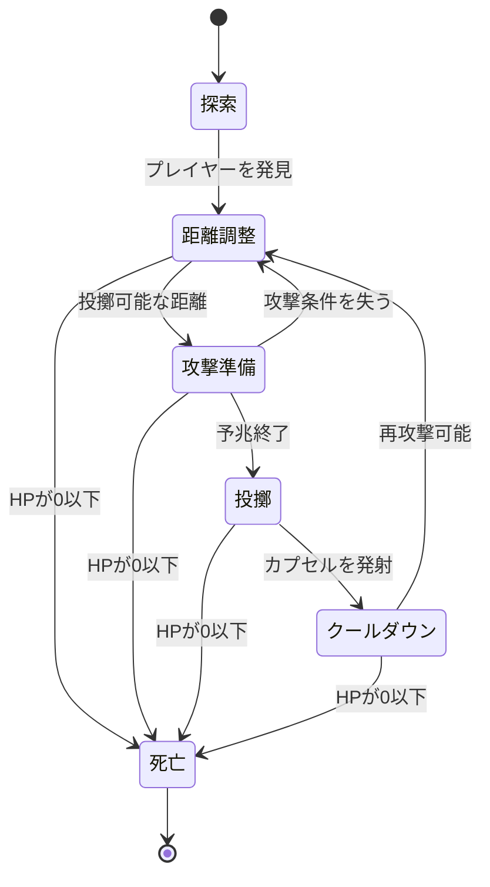

# 概要

## 基本情報

- **要素名（発音カタカナ）**：ポイズ
- **要素名（内部名・英文字）**：Poiz
- **語源**：英語の Poison（毒）をもとにした創作名
- **分類**：モンスター
- **状態**：設計中
- **関連する設定・要素**：[[プレイヤー]]、[[毒状態]]、[[移動速度低下]]、[[攻撃力低下]]、[[状態異常]]

## コンセプト・世界設定

### 一言コンセプト

毒入りカプセルを投げつけ、探索者を毒や各種弱体化状態に陥れる、浮遊型の遠距離攻撃モンスター。

### 世界での由来・背景

ポイズは、久遠の迷宮に生息する、薬品の調合と投擲を得意とする魔物である。

人間の医者を思わせる額帯鏡を頭部に装着しているが、負傷者を治療する医療従事者ではない。むしろ、薬品の作用を利用して生物を弱らせることに特化した、危険な毒剤調合師に近い存在である。

ポイズが使用するカプセルには、毒性を持つ液体や、身体の機能を一時的に妨げる特殊な薬剤が封入されている。カプセルは対象に命中すると破裂し、内部の薬剤が身体に付着することで状態異常を引き起こす。

ポイズ自身は非常に脆弱であり、敵の攻撃を受け止めたり、傷を回復したりする能力を持たない。そのため、相手との距離を保ちながら薬品を投げ続ける戦法を取る。

### 生息地・出現条件

ポイズは、迷宮内の研究室跡、薬品庫を思わせる固定マップや、通常のモンスターが出現するランダムマップに配置できる。

ただし、研究室や薬品庫を必須の出現条件にはしない。通常の迷宮の部屋にも出現できるようにし、世界観上の演出とゲーム上の出現条件を分離する。

出現段階は序盤後半から中盤を想定する。通常攻撃だけではなく状態異常への対処も必要になるため、プレイヤーが毒やデバフの仕組みに慣れた頃に登場させる。

### 見た目・大きさ・色

ポイズの外見は、医療器具を身につけた、二つのカプセル状の部位を持つ浮遊型モンスターである。

頭部は大きな薬用カプセルのような形状をしており、その正面に顔が描かれている。頭部上方には、医者が額につけている円形の額帯鏡が取り付けられている。

胴体もカプセル状で、頭部とは異なる大きさと向きにすることで、単なる巨大な薬の容器ではなく、人型の魔物として認識できるシルエットにする。

足は存在せず、胴体を浮かせて移動する。左右には細長い機械のアームのような腕が伸びており、その先端でカプセルや小瓶をつかみ、投げる。

配色は、毒薬を連想させる黄緑色と暗い緑色を基本にする。カプセルの両端には異なる色を配置し、医薬品の形状を見分けやすくする。額帯鏡には小さな銀色のハイライトを入れ、医者らしさを表現する。

2D見下ろし型の小さな画面でも認識できるように、次の特徴を優先する。

- 足がなく浮いていること。
- カプセル状の頭部と胴体。
- 額の円形鏡。
- 左右に伸びる細いアーム。
- 毒を連想させる緑色の配色。

細かな医療器具を大量に付けるのではなく、額帯鏡とカプセル状の身体を主要な識別要素とする。

### 性格・生態・用途

ポイズは、プレイヤーを発見すると距離を取りながら攻撃する、遠距離型のモンスターである。

敵を発見した際には、接近して直接攻撃するのではなく、薬品を投げられる距離まで移動して攻撃を開始する。接近された場合は、浮遊しながら後退し、再び投擲に適した距離を確保しようとする。

攻撃の中心は毒状態の付与である。ただし、使用する薬剤には複数の種類があり、低確率で移動速度低下や攻撃力低下などの異なる状態異常を引き起こす。

ポイズ自身は攻撃を受けることに弱く、剣による攻撃を一度受けるだけで撃破される。このため、遠距離から継続的に攻撃できる状況では危険だが、接近を許すと短時間で倒される。

### プレイヤーに伝えたい印象

「放置すると厄介だが、近づいて攻撃すれば簡単に倒せる敵」。

ポイズはHPの高さや大きな直接ダメージではなく、状態異常によってプレイヤーの行動を制限することを脅威とする。

また、見た目は医者を思わせるが、その能力は治療ではなく弱体化に使われる。この外見と役割の逆転も、ポイズの印象を形作る要素である。

# 物語的設定

## 起源

ポイズは、久遠の迷宮に蓄積した薬品と魔力が結びつき、独自の生命活動を獲得した魔物である。

その身体は薬用カプセルに似ており、外殻の内部には特殊な薬剤が循環している。薬剤は単なる体液ではなく、ポイズが攻撃用カプセルを調合するための材料でもある。

ポイズは長い時間をかけて薬剤の組み合わせを蓄積し、毒性を持つ薬剤だけでなく、身体の動きや筋力を一時的に妨げる薬剤も扱えるようになった。

ただし、ポイズは薬の効果を自在に操れるわけではない。調合には失敗もあり、投げたカプセルによっては狙った毒とは異なる弱体化効果が発生する。

この不安定さが、ポイズの攻撃に予測しにくい要素を与えている。

## 医者ではないポイズ

ポイズは医師ではない。額帯鏡を装着しているのは、医療技術を持つことを示すためではなく、薬品を扱う存在としての外見的な特徴である。

額帯鏡は本来、医療の現場で観察や照明に使用されてきた器具であり、一般的な医師の象徴としても知られている。ポイズはこの器具を身につけているものの、診察や治療を行うことはない。

ポイズにとって薬品は、他者を治療する道具ではなく、相手の能力を低下させるための武器である。

そのため、見た目こそ医者らしいが、ゲーム内の役割は治療役や支援役ではなく、状態異常を専門とする遠距離攻撃型モンスターとなる。

## 身体構造とカプセル

ポイズの頭部と胴体は、ともに硬い殻で覆われたカプセル状の器官である。

頭部には顔と額帯鏡が存在し、周囲の状況を認識して攻撃対象を選ぶ。胴体には薬剤を貯蔵する器官があり、アームを介して攻撃用カプセルを取り出せる。

ただし、外殻は見た目に反して衝撃に弱い。内部の薬剤を安定して保持するための構造になっているものの、物理的な攻撃を受け止める防御機構はほとんどない。

このため、剣による攻撃を受けると身体の構造が簡単に破壊され、活動を停止する。

## 攻撃用カプセルの仕組み

ポイズが投げるカプセルは、外殻の内部に薬剤を封じ込めた投擲武器である。

カプセルは対象に命中するか、壁などの障害物に衝突すると破裂する。命中した相手には薬剤が付着し、一定時間にわたって毒や弱体化の効果を引き起こす。

カプセルの色や内部の液体の色を変えることで、プレイヤーは異なる状態異常の種類を視覚的に区別できる。ただし、遠くからでも判別できるほど明確な色の違いを設ける必要があり、細かな模様だけで区別する設計は避ける。

## 他モンスターとの関係

### [[ゴブリン]]

ゴブリンが接近戦を中心とする一般的な敵であるのに対し、ポイズは距離を維持して攻撃する遠距離型モンスターである。

ゴブリンとポイズが同じ部屋に出現した場合、プレイヤーはゴブリンへの近接攻撃に集中している間も、後方からのカプセル投擲に注意する必要がある。

ただし、ポイズは脆弱なため、先に接近して倒すことができれば、戦闘の負担を大きく減らせる。

## 進化

現時点では、進化形態は設定しない。

将来的にバリエーションを追加する場合でも、単純にHPや攻撃力を増やすだけではなく、使用する薬剤の種類や投擲方法を変える方向が適している。

## 迷宮との関係

ポイズは、薬剤の材料となる特殊な魔力が存在する久遠の迷宮で活動する。

通常の敵と同様に、マップを探索し、プレイヤーを発見すると攻撃を開始する。迷宮に薬品庫や研究室が存在する場合は、そのような部屋に優先的に配置する演出も可能だが、特定の部屋にしか出現しない仕様にはしない。

# ゲーム内での役割

## プレイヤーが遭遇する状況

序盤後半から中盤にかけて、通常の敵と同時に出現させる。

初回遭遇時には、ポイズがプレイヤーから距離を取りながらカプセルを投げる様子を見せる。カプセルの命中によって毒状態が発生し、時間経過によって体力が減少することで、通常の直接攻撃とは異なる脅威であることを伝える。

## ゲームプレイ上の役割

ポイズは、状態異常を使ってプレイヤーの戦闘能力を低下させる遠距離攻撃型モンスターである。

毒状態によって継続的に体力を失わせるほか、低確率で移動速度や攻撃力を低下させる。そのため、単体では倒しやすくても、別の敵と同時に出現すると危険性が高まる。

一方、HPは非常に低い。攻撃を受け止めるよりも、接近を防ぎながら攻撃を続けることに強みがある設計であり、プレイヤーが接近して剣を当てられれば短時間で撃破できる。

## プレイヤーに促す判断・行動

ポイズとの戦闘では、状態異常を受け続ける前に接近して倒すか、盾や移動を使って攻撃を避けながら戦うかを判断させる。

特に、ゴブリンなどの近接型モンスターと同時に出現した場合は、近接敵を先に処理するか、後方のポイズを先に狙うかという優先順位が発生する。

## 他のモンスターとの違い

ポイズの主な差別化要素は、状態異常に特化した遠距離攻撃と、極端に低い耐久力の組み合わせである。

一般的な遠距離型モンスターが直接ダメージを与えることを中心とするのに対し、ポイズは継続ダメージや能力低下を与えることで、プレイヤーの戦闘を不利にする。

また、カプセル状の頭部と胴体、額帯鏡、機械的なアーム、浮遊する移動方法によって、外見上も識別しやすくする。

## 想定する難易度・進行段階

**出現段階：序盤後半～中盤。**

毒や状態異常が初めて登場する場合は、ほかの敵が少ない部屋で単独配置し、攻撃と状態異常の仕組みを学習させる。

慣れた後は、ゴブリンなどの近接型モンスターと組み合わせる。ポイズ自身のHPは低いため、同時出現数を増やすよりも、別の敵との位置関係によって難易度を調整する。

# プレイヤーから見える仕様

## 通常時の挙動

ポイズは通常のエネミーAIに従ってマップ内を探索する。

プレイヤーを発見した場合、攻撃可能な距離を保ちながら接近し、カプセルを投げる。プレイヤーが接近してきた場合は後退し、再び投擲に適した距離を確保しようとする。

ただし、移動速度は低めであり、プレイヤーを永久に振り切ることはできない。壁やバリケードによって移動経路が塞がれている場合も、通常の経路探索に従って移動する。

## 遠距離攻撃：薬剤カプセル

ポイズは、アームでカプセルを取り出し、プレイヤーに向かって投げる。

カプセルは投擲開始時点のプレイヤーの位置を狙って飛ぶ。発射後にプレイヤーを追尾することはないため、移動によって回避できる。

投擲前には、アームを後ろへ引き、使用するカプセルを持ち上げる予兆を表示する。予兆は0.45秒とし、見てから移動することで回避できる時間を確保する。

投げられたカプセルは、プレイヤー、壁、バリケードなどに接触すると破裂する。破裂時には小さな薬液の飛散エフェクトを表示し、対象に状態異常を付与する。

### 投擲仕様

| 項目 | 値・範囲 | 補足 |
| --- | --- | --- |
| 攻撃種別 | 遠距離投擲 | 薬剤入りカプセル |
| 攻撃予兆時間 | 0.45秒 | アームを引く動作 |
| 攻撃間隔 | 3.6秒 | 投擲開始から次の投擲まで |
| 攻撃射程 | プレイヤーの体幅4～6個分を目安 | 壁などの障害物によって制限 |
| 弾速 | ゴブリンの移動速度と同程度を初期案とする | 回避可能な速さに調整 |
| 爆発範囲 | プレイヤーの体幅0.5個分程度 | 小範囲。広範囲の制圧は行わない |
| 追尾 | なし | 投擲時の位置を狙う |
| 弾数 | 制限なし | ゲーム内の弾薬管理は不要 |

投擲間隔と弾速は、プレイヤーが連続して回避行動を取れるよう調整する。ポイズ自身のHPが低いことも踏まえ、攻撃を避けられずに長時間状態異常を受け続ける状況は避ける。

## 状態異常の種類

ポイズの攻撃は毒状態が中心であり、低確率で別の弱体化効果が発生する。

| 状態異常 | 発生確率 | 効果 | 効果時間 |
| --- | ---: | --- | --- |
| 毒 | 80% | 一定間隔で体力が減少する | 4秒 |
| 移動速度低下 | 12% | 移動速度が30%低下する | 2.5秒 |
| 攻撃力低下 | 8% | 攻撃力が25%低下する | 3秒 |

確率は、命中したカプセル1個につき1回抽選する。

毒以外の効果は低確率で発生するため、基本的には毒への対処を中心にしつつ、ときどき異なる弱体化を受ける可能性がある。

この確率は初期案である。毒の継続ダメージやゲーム全体の状態異常の強さに合わせて調整する。

### 毒状態

毒状態になると、プレイヤーの体力が一定間隔で減少する。

毒の継続時間は4秒とし、1秒ごとに最大4回のダメージ判定を行う。1回あたりのダメージは、ゴブリンの通常攻撃1回分の15%相当を初期案とする。

毒のダメージによってHPが0以下になった場合は、通常の死亡処理に移行する。

### 移動速度低下

移動速度低下を受けると、プレイヤーの移動速度が通常時の70%になる。効果時間は2.5秒。

攻撃回避が難しくなるため、ポイズ以外の敵が近くにいる状況では特に注意が必要になる。

### 攻撃力低下

攻撃力低下を受けると、プレイヤーの攻撃ダメージが通常時の75%になる。効果時間は3秒。

この状態はポイズ自身へのダメージ効率も低下させるため、早期撃破を狙うプレイヤーにとって不利な効果となる。

## 発動条件・操作方法

ポイズの攻撃は自動で行われる。プレイヤー専用の操作は必要ない。

プレイヤー側は通常の移動と盾による防御、マウス方向への剣攻撃によって対応する。

カプセルは追尾しないため、予兆を確認して移動すれば回避できる。また、ポイズのHPは低く設定するため、攻撃を避けながら接近して剣を当てることも有効な対策となる。

## 効果時間・クールダウン

毒、移動速度低下、攻撃力低下は、それぞれ独立した状態異常として管理する。

同じ状態異常を再度受けた場合、同じ効果を重ねて強化することはしない。効果時間を更新する方式を基本とする。

異なる状態異常は同時に発生する可能性がある。例えば、毒状態の最中に移動速度低下を受けた場合、毒の継続ダメージを受けながら移動速度も低下する。

ただし、効果時間を無制限に延長できてしまわないよう、再付与の扱いには上限を設けることを推奨する。

## 撃破時の結果

ポイズは、プレイヤーの剣による攻撃を一度受けると撃破される。

撃破時は身体が破裂し、内部の薬剤が散るような短いエフェクトを表示する。通常の死亡処理に従い、攻撃判定、投擲処理、状態異常の付与処理を終了する。

固有ドロップは現段階では設定しない。薬剤を利用したアイテムの実装を行う場合は、ポイズの撃破報酬とは別に、アイテムやクラフト素材として追加するか検討する。

# 数値・バランス

| 項目 | 値・範囲 | 補足 |
| --- | --- | --- |
| HP / 耐久度 | ゴブリン0.2体分相当を仮置き | プレイヤーの剣による攻撃1回で確実に撃破 |
| 攻撃力 | ゴブリン通常攻撃の0.25倍相当 | カプセル直撃による初期ダメージ |
| 毒の継続ダメージ | ゴブリン通常攻撃の0.15倍相当 / 回 | 1秒ごとに最大4回 |
| 移動速度 | ゴブリンの0.55倍 | 遅め。浮遊移動 |
| 接近時の後退速度 | 通常移動速度の1.2倍 | 距離を取るための移動 |
| 攻撃間隔 | 3.6秒 | 次のカプセルを投げるまで |
| 攻撃予兆時間 | 0.45秒 | 回避のための猶予 |
| 攻撃射程 | 体幅4～6個分を目安 | 壁などの障害物を考慮 |
| 状態異常付与率 | 命中時100% | 毒80%、移動速度低下12%、攻撃力低下8% |
| 固有ドロップ率 | なし | 固有ドロップ自体を未設定 |
| 想定出現段階 | 序盤後半～中盤 | 状態異常に慣れた段階 |

※能力値は調整用の初期案。ゴブリンの実際のHPや攻撃力が決まった段階で比較基準を統一する。

# 実装仕様（Unity）

## 挙動の流れ

1. **開始条件**

   ポイズがマップ上に生成されると、HP、移動速度、攻撃間隔、投擲状態などを初期化する。

   ポイズは浮遊型モンスターとして扱い、足のアニメーションや歩行処理は持たせない。

2. **探索**

   通常のエネミーAIと同じく、マップ内を探索する。プレイヤーを発見すると追跡対象として登録し、投擲可能な距離まで移動する。

3. **距離の維持**

   プレイヤーとの距離が十分にある場合は、投擲位置を確保するために移動する。近づかれすぎた場合は後退を試みる。

   後退先が壁やバリケードによって塞がれている場合は、別の通行可能な位置を探す。距離を確保できない場合は、その場から攻撃するか、通常の経路探索へ戻る。

4. **攻撃準備**

   攻撃可能な距離に入り、攻撃対象への射線が確保されると、アームを引いてカプセルを構える。

   0.45秒間の予兆を表示する。この間にプレイヤーが射程外へ移動した場合は、投擲を中止して通常の移動へ戻る。

5. **カプセル投擲**

   カプセルをプレイヤーの現在位置へ向けて投げる。投擲後のカプセルは、設定された速度で直線移動する。

   発射後はプレイヤーを追尾しない。壁やバリケードに衝突した場合は、その位置で破裂させる。

6. **命中判定と状態異常**

   カプセルがプレイヤーに命中するか、十分に近い位置で破裂した場合、直接ダメージと状態異常の判定を行う。

   命中時に状態異常の種類を抽選し、毒、移動速度低下、攻撃力低下のいずれかを付与する。

7. **再攻撃**

   投擲後はクールダウンを開始し、3.6秒経過するまで次の攻撃を行わない。

   プレイヤーが接近してきた場合は、攻撃クールダウン中でも距離を取るために移動できる。

8. **死亡**

   HPが0以下になると死亡状態へ移行する。移動、投擲、攻撃判定、状態異常付与処理を停止し、通常の死亡演出を再生する。

## 状態遷移

## 実装上の注意

### 浮遊移動

ポイズには足を設けず、XY軸の移動に加えて、スプライトをわずかに上下させるアニメーションを使用する。

浮遊アニメーションのために実際のコライダーを大きく上下させる必要はない。移動と接触判定は通常の2Dモンスターとして安定させ、見た目だけを上下させる。

### カプセルの投擲

カプセルは独立した投擲用オブジェクトとして生成する。ポイズ本体のコライダーとカプセルのコライダーを分離し、投擲中のカプセルが本体に当たって消滅しないようにする。

カプセルの発射時にプレイヤーの位置を取得し、その座標へ向けた速度を計算する。発射後は目標座標を更新せず、プレイヤーが移動しても追尾しない方式とする。

### 状態異常の管理

状態異常は、ポイズ専用の処理として独立させるのではなく、既存の[[状態異常]]システムを利用する。

毒による継続ダメージ、移動速度低下、攻撃力低下は、それぞれ既存の効果処理へ接続する。同じ効果を複数回受けた場合は、効果時間の更新など、ゲーム全体で統一されたルールに従う。

### 撃破処理

ポイズのHPが0以下になった場合は、死亡状態を優先する。攻撃準備中や投擲直後に撃破された場合でも、死亡したポイズから追加のカプセルが生成されることのないようにする。

# 演出・操作感

## アニメーション・見た目の変化

通常時は、身体を少し上下させながら浮遊する。左右のアームは身体の動きに合わせてゆっくり揺れ、額帯鏡が光を反射する。

攻撃準備時には、片方のアームを後ろへ引き、カプセルを持ち上げる。カプセルを投げる瞬間にはアームを前方へ伸ばし、投擲方向へ身体を少し傾ける。

カプセルが破裂したときは、薬液が飛び散る短いエフェクトを表示する。毒は黄緑色、移動速度低下は青色、攻撃力低下は紫色など、状態異常ごとに明確に色を分ける。

撃破時には頭部と胴体の外殻が割れ、内部の液体が飛び散るような演出を行う。ただし、撃破時の演出で状態異常が新たに発生することはない。

## 効果音・BGM

通常の浮遊移動には、小さな機械音や低い浮遊音を使用する。

攻撃準備では、薬品の入ったカプセルを持ち上げる音を鳴らし、投擲時には空気を切る短い音を使用する。カプセルが破裂すると、液体の飛散を思わせる音を鳴らす。

状態異常が付与された際には、通常の被弾音とは異なる短い音を使用し、直接ダメージだけでなくデバフが発生したことをプレイヤーに伝える。

専用BGMは設定せず、通常の部屋のBGMを使用する。

## エフェクト

ポイズのエフェクトは、薬剤の違いを視覚的に識別できるようにすることを優先する。

- 毒：黄緑色の薬液が飛び散り、毒状態を示す小さな粒子を表示する。
- 移動速度低下：青色の薬液が広がり、移動速度低下のアイコンを表示する。
- 攻撃力低下：紫色の薬液が飛び散り、攻撃力低下のアイコンを表示する。

エフェクトは小さな画面でも見分けられるようにし、画面全体を覆うような大きな演出は避ける。

## UI・ログ・説明文

専用HPバーは設けない。ポイズはHPが低く、剣による攻撃1回で倒せるため、通常の敵と同じ簡易表示だけでも十分に識別できる。

状態異常を受けたときは、既存の状態異常UIを利用する。新しい状態異常が発生した際には、アイコンと残り時間によって効果を確認できるようにする。

**図鑑説明文案**

「額に鏡をつけた、浮遊するカプセル型の魔物。医者のような姿をしているが、投げつけるのは治療薬ではなく、身体を蝕む危険な薬剤である。毒を中心に、移動速度や攻撃力を低下させるカプセルも使用する。身体は脆く、剣の一撃で簡単に倒せる。」

## 操作・フィードバック上の注意

状態異常の種類は、命中した後に初めてわかる場合でも、効果アイコンによってプレイヤーが識別できるようにする。

また、ポイズは遠距離から状態異常を繰り返し与えるため、投擲前の予兆とカプセルの飛翔速度を適切に設定する。回避できる攻撃であることを明確にし、何もできないまま継続的に弱体化させられる状況を避ける。

# 例外・確認項目

## 同時発生・連続使用時

複数のポイズが出現した場合、各個体の攻撃クールダウンは独立して管理する。

ただし、複数体が同時に投擲を行うと、回避可能な空間が狭くなり、状態異常を受け続ける危険がある。序盤では同時出現数を1体に制限し、慣れたプレイヤー向けの部屋でのみ複数体を配置する。

同じ状態異常が重複した場合は効果時間を更新し、ダメージや能力低下の値そのものは重ねない。異なる状態異常は同時に発生できるものとする。

## 壁・段差・地形との関係

カプセルは壁を貫通しない。壁やバリケードに衝突した場合はその場で破裂し、通常の命中判定を行う。

プレイヤーとの間に壁がある場合、ポイズは壁越しに攻撃を成立させず、通常の経路探索によって攻撃可能な位置を探す。

水やマグマの移動速度補正は、通常の地形判定に従う。ポイズに特殊な地形耐性を設ける必要はない。

奈落に落ちる経路は選択しない。移動先が通行不能になった場合は別の経路を探索する。

## 死亡・ステージ移動・一時停止時

ポイズが死亡した場合、進行中の投擲準備と攻撃処理を停止する。すでに生成されたカプセルは、既存の敵弾の処理規則に従う。

ステージ移動時は、ポイズ本体と敵弾を通常のステージ移動処理に従って破棄する。

一時停止中は、移動、投擲、カプセルの移動、クールダウン、状態異常の残り時間を停止する。

## 他の効果との重複・競合

ポイズの状態異常は、プレイヤーがアイテムなどから受ける状態異常と同じ仕組みで管理する。

毒状態の継続ダメージと、カプセルの直撃ダメージは別の処理にする。カプセルが命中したフレームに直撃ダメージを計算し、その後、毒状態の継続ダメージは既定の間隔で発生させる。

盾は、既存の盾システムに従って直接ダメージを軽減する。盾で軽減された場合でも、カプセルの薬液がプレイヤーに付着する仕様では状態異常が発生する可能性があるため、盾で状態異常まで防ぐかどうかは、ゲーム全体の防御ルールと合わせて決定する。

## プレイヤーに誤解されそうな点

ポイズは医者の姿をしているが、回復能力を持つモンスターではない。額帯鏡は見た目の特徴であり、治療行為を行うわけではない。

また、投げるカプセルは通常の直接攻撃だけでなく、状態異常を付与するための武器である。ダメージ自体が小さくても、毒やデバフによって戦闘が不利になることがある。

本体は脆弱であり、接近して剣を当てれば一撃で撃破できる。この弱点を見た目とゲーム内仕様の両方で明確にする。

# 関連記事・参考ページ

## 関連するObsidian記事

- [[プレイヤー]]：状態異常の対象となる操作キャラクター。
- [[ゴブリン]]：標準的な敵との強さ比較。
- [[ディッツ]]：カプセル状の外見を持つ別モンスター。役割と移動方法を区別する。
- [[リアファニス]]：奇襲型モンスターとの戦闘上の差別化。
- [[毒状態]]：継続ダメージを発生させる状態異常。
- [[移動速度低下]]：移動速度を一時的に低下させる効果。
- [[攻撃力低下]]：攻撃ダメージを一時的に低下させる効果。
- [[状態異常]]：各種デバフの共通処理。

※リンク先は関連記事の候補であり、既存の記事が存在することを保証するものではない。

## 参考資料

- [Minecraft Wiki — Witch](https://minecraft.wiki/w/Witch)
  - Minecraftのウィッチが投擲ポーションで攻撃し、防御用ポーションも使用することを確認するための参考資料。
  - ポイズでは、浮遊するカプセル型の身体、額帯鏡、低い耐久力、状態異常を中心とした投擲攻撃を独自の特徴として扱う。

- [Etymonline — Poison](https://www.etymonline.com/word/poison)
  - 英語の poison の語源を確認するための参考資料。
  - 古フランス語の poison とラテン語 potio に由来する語であることが説明されている。
  - 「Poiz」は、この英単語の語感をもとにした創作名として扱う。

- [PubMed — The Head Mirror: How This Otolaryngological Instrument Became the Symbol for Physicians](https://pubmed.ncbi.nlm.nih.gov/41639603/)
  - 額帯鏡の歴史と、医師を表す象徴的な器具として広く用いられてきたことを確認するための参考資料。

- [久遠の迷宮・モンスター募集作品](https://scratch.mit.edu/projects/1382505113)
  - 応募原案の確認先。

- [久遠の迷宮・Scratch版](https://scratch.mit.edu/projects/1169722485/)
  - 元となるゲームの確認先。

## 作業メモ

### 未決定事項

- **毒の継続ダメージ**：ゴブリンの通常攻撃1回分の15%相当を1秒ごとに与える初期案。既存の毒状態の仕様に合わせて調整する。
- **状態異常の確率**：毒80%、移動速度低下12%、攻撃力低下8%を初期案とする。
- **盾による状態異常の防止**：既存の盾システムとの整合性を確認する。
- **固有ドロップ**：現時点では設定しない。薬品関連アイテムを追加する場合は別途検討する。

### 実装・調整タスク

1. 浮遊する移動アニメーションを作成する。
2. 距離を維持しながら攻撃するAIを実装する。
3. 薬剤カプセルの投擲と破裂判定を実装する。
4. 毒、移動速度低下、攻撃力低下の抽選処理を実装する。
5. 状態異常の効果時間と重複処理を既存システムに接続する。
6. 剣の攻撃1回で確実に撃破できるHPに設定する。
7. 複数体の同時出現時に、連続被弾が発生しすぎないことを確認する。

### 確認方法

- 霧や暗い背景のない通常の部屋でも、カプセル型の頭部と額帯鏡によって識別できるか確認する。
- 投擲前の予兆を認識でき、移動によってカプセルを回避できるか確認する。
- 毒状態の継続ダメージと残り時間が正しく表示されるか確認する。
- 移動速度低下と攻撃力低下が、指定された時間だけ適用されるか確認する。
- ポイズに接近して剣を一度当てた場合、確実に撃破できるか確認する。
- 壁やバリケードによって攻撃が遮られるか確認する。
- 撃破時に追加の攻撃や状態異常が発生しないか確認する。

- **関連ファイルへのリンク**：[[毒状態]]、[[移動速度低下]]、[[攻撃力低下]]、[[状態異常]]
- **更新日**：2026-10-18