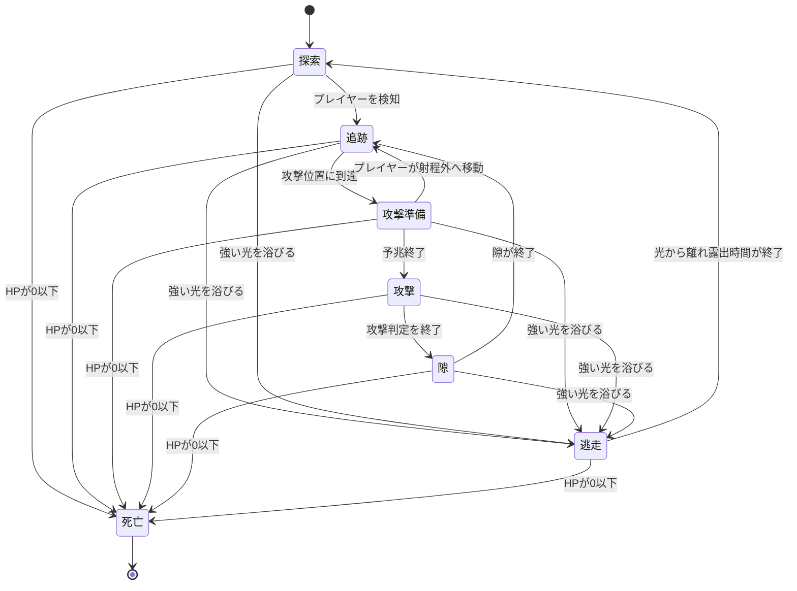

# 概要

## 基本情報

- **要素名（発音カタカナ）**：リアファニス
- **要素名（内部名・英文字）**：Riafanis
- **語源**：ギリシャ語 διαφανής（diafanís／ディアファニス）
- **語源の意味**：「透明な」「透き通った」
- **分類**：モンスター
- **状態**：設計中
- **関連する設定・要素**：[[霧の迷宮]]、[[光源ギミック]]、[[プレイヤー]]、[[ゴブリン]]、[[霧透膜]]

## コンセプト・世界設定

- **一言コンセプト**：霧の中に溶け込み、姿を見せずに探索者の背後へ回り込んで襲う、透明な高速奇襲型モンスター。
- **世界での由来・背景**：久遠の迷宮の内部で発生する特殊な魔力によって、身体を透過性の高い状態に変化させた人型生物。周囲の光を通過させるだけでなく、輪郭を周囲の景色に紛れ込ませる能力を持つ。
- **生息地・出現条件**：霧が恒常的に発生する部屋、視界の悪い回廊、霧を発生させる地形ギミックのある部屋。霧のない通常の部屋には原則として出現しない。
- **見た目・大きさ・色**：
  - 人間に近い二足歩行の体型。
  - 身長はプレイヤーキャラクターとほぼ同程度。
  - 身体は半透明で、内部の輪郭や奥側の景色がわずかに透けて見える。
  - 通常時は青灰色を基調とし、輪郭付近に淡い白色の屈折光が現れる。
  - 足元と身体の周囲には、薄い煙のような歪みが発生する。
  - 強い光を浴びると、身体の輪郭が白く浮き上がり、透明化が不完全になる。
- **性格・生態・用途**：
  - 正面からの戦闘を避け、獲物の背後へ回り込む。
  - 体力と防御力が低く、真正面から攻撃を受け続けると簡単に倒される。
  - 反対に、透明化と高い移動速度を利用して、通常の武器攻撃を回避することに長ける。
  - 強い光を嫌い、照射されると攻撃を中断して暗い霧の中へ逃げようとする。
- **プレイヤーに伝えたい印象**：最初は正体がわからず、突然背後から攻撃される不気味な敵。しかし、周囲の景色の歪みと光への反応を理解すれば、弱点を突いて倒せる。

# 物語的設定

## 起源

リアファニスは、久遠の迷宮の霧が濃い領域で生まれた人型の魔物である。

迷宮の霧には、光を散乱させ、物体の輪郭を曖昧にする性質がある。長い年月を霧の中で過ごしたリアファニスは、この性質を自らの身体に取り込み、光を受けても姿が明瞭に映らない身体へ変質した。

この変化によって、リアファニスは視覚に頼る生物から発見されにくくなった。その代わり、身体の維持に必要な魔力を安定して供給できる環境が限られるようになった。霧の薄い場所や強い光が差し込む場所では、透明化能力が低下する。

## 身体構造と透明化の仕組み

リアファニスの身体は、完全に存在しないわけではない。身体そのものは実体を保っており、地面を歩き、壁や障害物に衝突し、武器によるダメージも受ける。

ただし、通常時は身体の表面で光が屈折し、周囲の風景と重なるように見える。そのため、プレイヤーからは本体の位置を正確に把握しにくい。

透明化中でも、次の痕跡は完全には消えない。

- 移動する際、足元に円形の薄い霧が残る。
- 方向転換時、輪郭の屈折が一瞬だけ大きくなる。
- 攻撃前には、身体の周囲の霧が後方へ引き伸ばされる。
- 強い光を受けると、輪郭と身体の内部構造が白く浮かび上がる。

これらの現象によって、プレイヤーは姿が見えない場合でも、リアファニスの接近や攻撃の予兆を推測できる。

## 影響

リアファニスが生息する部屋では、周囲の霧が不自然に揺れることがある。

これはリアファニスが高速で移動している際、身体の周囲にある霧を押し分けているためである。熟練した探索者は、霧の流れや局所的な歪みを観察して、隠れている個体を見つける。

一方、霧の流れが複雑な部屋では、リアファニスの痕跡と通常の霧の動きを区別しにくくなる。

## 他モンスターとの関係

- **[[ゴブリン]]**：
  リアファニスの比較対象となる一般的な敵。ゴブリンが通常の視認と追跡によって獲物を襲うのに対し、リアファニスは透明化と背後への回り込みによって奇襲を成立させる。両者の関係は、同じ霧の部屋に出現しても異なる対処方法を要求する敵同士として設計する。

- **[[霧の迷宮]]**：
  霧が濃い環境は、リアファニスの透明化と接近戦を支える。霧が薄くなる場所では、リアファニスは姿を隠し続けることが難しくなる。

- **[[光源ギミック]]**：
  強い光はリアファニスの透明化を阻害する。光源のある部屋では逃げ場を探して移動するため、普段とは異なる行動を見せる。

※上記の関連記事は世界設定上の関係案。既存の記事やモンスターの確定仕様を示すものではない。

## 進化

現在、進化形態は設定しない。

同じ種類の個体でも、透明化能力や移動速度には個体差がある。ただし、これは個体ごとの能力値の違いとして扱い、別モンスターや進化形態としては扱わない。

## 迷宮との関係

リアファニスは霧の濃い領域に定着している。迷宮の構造が変化して霧の部屋が新たに生成された場合、そこに移動して生息域を広げることがある。

しかし、霧のない場所で長期間行動することは苦手である。強い光や霧の消失によって透明化を維持できなくなると、より条件のよい部屋へ逃げようとする。

# ゲーム内での役割

- **プレイヤーが遭遇・入手する状況**：
  霧のある固定マップまたはランダム生成マップで遭遇する。初回遭遇時には、姿が見えないまま背後から攻撃され、敵の存在に気付く構成が望ましい。

- **ゲームプレイ上の役割**：
  通常の敵のように正面から攻撃するだけでは倒しにくい、対処法の理解を求める奇襲型モンスター。

- **プレイヤーに促す判断・行動**：
  1. 周囲の霧の歪みを観察する。
  2. 背後や側面を警戒する。
  3. 攻撃の予兆を見て移動し、奇襲を回避する。
  4. 攻撃直後に一瞬だけ露出する本体を狙う。
  5. 強い光を利用し、透明化を崩して追い払う。

- **他の要素との違い**：
  通常のモンスターは位置が見えていることを前提に戦えるが、リアファニスは位置の特定そのものが戦闘上の課題となる。高いHPや強力な攻撃ではなく、透明化と機動力が脅威の中心である。

- **想定する難易度・進行段階**：
  序盤後半から中盤。霧の地形と通常の敵への対処に慣れたプレイヤーに、新しい戦闘上の判断を要求する敵として配置する。

- **同時出現数**：
  初回遭遇では1体。慣れたプレイヤー向けの部屋では最大2体を基本とする。複数体が同時に背後を取ると攻撃の予測が難しくなるため、3体以上の同時配置は原則として避ける。

# プレイヤーから見える仕様

## 通常時の挙動

- リアファニスは霧の部屋を巡回しながら、プレイヤーを探索する。
- プレイヤーを発見すると、正面から直進するのではなく、側面や背後に回り込む経路を探す。
- 背後への移動中は透明化を維持する。
- 接近後、短い予兆を見せてから近接攻撃を行う。
- 攻撃後は一時的に輪郭が明瞭になる。この間は通常の武器攻撃でダメージを与えられる。
- HPが低いため、透明化を崩して攻撃できれば比較的短時間で倒せる。

## 攻撃方法：背後からの奇襲

- **攻撃種別**：近接攻撃
- **攻撃対象**：プレイヤー
- **攻撃条件**：プレイヤーとの距離が一定以内で、背後または側面から攻撃可能な位置にいること。
- **攻撃開始距離**：プレイヤーの体幅約0.7個分以内。
- **予兆時間**：0.45秒。
- **攻撃後の隙**：0.7秒間、通常より本体が見えやすくなる。
- **攻撃間隔**：2.2秒。
- **射程**：短い。遠距離攻撃は行わない。

攻撃開始時には、リアファニスの周囲の霧が背後から前方へ細長く伸びる。この変化が攻撃の直前予兆となる。

攻撃は一瞬で決着するものではなく、予兆を見て移動すれば回避可能とする。

## 発動条件・操作方法

リアファニスはプレイヤーの入力を直接検知するのではなく、プレイヤーの位置を基準に行動する。

プレイヤー側には専用の操作を追加せず、通常の移動、マウス方向への剣攻撃、盾による防御、光源の利用で対処できる設計とする。

背後の判定は、プレイヤーの現在の向き、または最後に攻撃を向けた方向を基準にする。実装時は、プレイヤーの向きをどの情報から取得するかを統一する。

## 透明化と攻撃判定

リアファニスは透明化している間、通常の敵より位置を把握しにくい。

ただし、透明化を理由に無条件で無敵にすると理不尽な戦闘になるため、次のように扱う。

- **通常の透明化中**：本体は極めて見えにくい。攻撃判定は存在するが、プレイヤーは本体の位置を推測して攻撃する必要がある。
- **攻撃直後**：0.7秒間、輪郭が明瞭になり、通常どおり攻撃できる。
- **強い光を受けた場合**：透明化が崩れ、身体がはっきり見える。照射中および照射直後は攻撃を当てやすくする。
- **ダメージを受けた場合**：被弾演出として一瞬だけ輪郭を強調する。

透明化中の攻撃を一律に無効化する仕様にはしない。攻撃できる瞬間を用意することで、観察と反撃が成立するようにする。

## 弱点：強い光

強い光は、リアファニスの透明化を維持する能力を妨げる。

- **発動条件**：強い光の範囲内に0.3秒以上連続して入る。
- **照射時の効果**：透明化が崩れ、本体が明瞭に見える。
- **リアファニスの行動**：プレイヤーへの攻撃を中断し、光源から遠ざかる方向へ逃げる。
- **逃走速度**：通常移動速度の1.8倍。
- **照射終了後の露出時間**：1.5秒。
- **再攻撃**：光から十分に離れ、露出時間が終了した後に再び接近する。

照射中は逃走を優先し、プレイヤーへの攻撃を行わない。

光による逃走は、プレイヤーにとって安全を確保する手段であると同時に、透明化を崩してダメージを与える機会でもある。

なお、ゲーム内に強い光を発するアイテムやギミックが存在しない場合、この弱点を成立させるための仕組みが別途必要になる。新しい装備を増やす前に、既存の光源やエフェクトを利用できるか確認する。

## 効果時間・クールダウン

- **通常の透明化**：霧のある部屋で、条件を満たす限り維持する。
- **攻撃後の露出時間**：0.7秒。
- **強い光を浴びた後の露出時間**：1.5秒。
- **光を浴びている間**：透明化を解除し、逃走を優先する。
- **次の攻撃までの時間**：前回の攻撃開始から2.2秒以上。

露出時間は攻撃後と光照射後で別々に管理し、光による露出が通常の攻撃後の露出より優先されるようにする。

## 解除・終了条件

- HPが0になると死亡する。
- 光の照射が終了し、露出時間が終了すると、霧のある環境で透明化を再開する。
- 強い光から離れた後も、攻撃のクールダウンが残っている場合は、クールダウン終了まで攻撃しない。
- 部屋から出現条件が失われた場合、通常の敵の部屋移動・消滅ルールに従う。

## 失敗時・無効時の挙動

- 光源が弱く、照射条件を満たさない場合、透明化は解除されない。
- 光の範囲外では、光による逃走行動を開始しない。
- 攻撃予兆中にプレイヤーが離れた場合、攻撃を空振りし、攻撃後の隙に移行する。
- 壁やバリケードによって逃走経路が塞がれた場合、通行可能な別経路を探す。それでも経路を確保できなければ、通常の経路探索失敗処理を行う。

## 撃破時の結果

リアファニスは通常のモンスターと同じく死亡し、通常のドロップ処理に入る。

- ステージ固有のアイテム：そのステージの通常ドロップ規則に従う。
- モンスター固有のアイテム：低確率で「霧透膜」を落とす。
- ドロップしたアイテムは、通常のアイテム拾得処理で回収できる。

# 数値・バランス

| 項目 | 値・範囲 | 補足 |
| --- | --- | --- |
| HP / 耐久度 | ゴブリン0.7体分 | 通常のゴブリンより低耐久。一般的な武器なら少ない攻撃回数で倒せる想定 |
| 攻撃力 | ゴブリン0.7体分 | 通常攻撃1回あたりの比較値。実際の被ダメージは防具などの計算に従う |
| 移動速度 | ゴブリン1.8倍 | 背後へ回り込む能力の中核 |
| 逃走速度 | 通常速度の1.8倍 | 強い光を浴びている間 |
| 攻撃開始距離 | プレイヤー体幅0.7個分以内 | 密着に近い距離 |
| 攻撃予兆時間 | 0.45秒 | 回避の判断に必要な猶予 |
| 攻撃間隔 | 2.2秒 | 攻撃の連続化を防ぐ |
| 攻撃後の露出時間 | 0.7秒 | 通常の反撃機会 |
| 光照射の必要時間 | 0.3秒 | 一瞬光がかすめただけでは逃走しない |
| 光照射後の露出時間 | 1.5秒 | 強い光を受けた際の反撃機会 |
| 固有アイテムドロップ率 | 20% | 霧透膜の初期案 |
| 出現条件 | 霧のある部屋 | 霧のない部屋には原則として出現しない |
| 同時出現数 | 1～2体 | 初回遭遇は1体を推奨 |

※数値はすべて調整用の提案値。ゴブリンの実際の能力値が確定した時点で、比較基準を統一する。

# 実装仕様（Unity）

## 挙動の流れ

1. **開始条件**
   - 霧のある部屋に配置される。
   - HP、移動速度、攻撃間隔、透明化状態を初期化する。
   - 通常時は透明化し、周囲に薄い歪みエフェクトを表示する。

2. **探索**
   - 通常のエネミーAIと同様にマップ内を探索する。
   - プレイヤーを検知したら、追跡対象として登録する。
   - 追跡時はプレイヤーへ最短距離で直進せず、側面・背後へ回り込む経路を求める。

3. **接近**
   - 攻撃可能な距離に入るまで移動する。
   - プレイヤーの背後に回り込めない場合は、側面からの攻撃位置を探す。
   - 近接可能な位置に到達すると攻撃準備へ移行する。

4. **攻撃準備**
   - 0.45秒間の予兆を表示する。
   - 予兆中にプレイヤーが離れた場合は攻撃を中止する。
   - 攻撃準備中は攻撃クールダウンを二重に開始しない。

5. **攻撃**
   - 近接攻撃判定を一度だけ発生させる。
   - 命中・空振りにかかわらず、攻撃後の隙へ移行する。
   - 次の攻撃がすぐに発生しないようにクールダウンを管理する。

6. **攻撃後の隙**
   - 0.7秒間、輪郭を明瞭にする。
   - この期間は通常の武器攻撃でダメージを与えられる。
   - 隙が終了したら透明化へ戻る。ただし、光による露出が残っている場合は透明化しない。

7. **光への反応**
   - 強い光の範囲内に0.3秒以上連続して入ったら透明化を解除する。
   - 攻撃を中断し、光源から遠ざかる方向へ移動する。
   - 逃走中は攻撃を行わない。
   - 光による露出時間が終了し、光源から離れていれば通常の探索へ戻る。

8. **死亡**
   - HPが0以下になったら行動を停止する。
   - 攻撃判定、追跡処理、透明化処理を終了する。
   - 撃破エフェクトを再生し、通常のドロップ処理を実行する。
   - ドロップ生成後、死亡時のアイテム処理を終了する。

## 状態遷移

## 実装上の注意

- **透明化と当たり判定は分離する**：
  見た目を透明にしても、コライダーやHP判定まで無効にしてはいけない。透明化中も物理的な実体は維持する。
- **描画方法**：
  半透明スプライトだけでは背景によって本体が認識できなくなる可能性がある。周囲の霧の歪み、輪郭の屈折、足元のエフェクトを組み合わせる。
- **攻撃判定**：
  攻撃準備と攻撃判定の発生を分離する。予兆中に攻撃ダメージが発生しないようにする。
- **経路探索**：
  背後へ回り込む目標地点が壁の向こうにある場合は、到達可能な側面の位置を代替目標にする。
- **光源判定**：
  光源ごとに強度と有効範囲を設定し、一定以上の光だけを弱点として扱う。通常の背景光で常時逃げる仕様にはしない。
- **状態管理**：
  攻撃後の露出時間と光による露出時間は独立して管理する。光による露出時間が残っている間は、攻撃後の隙が終了しても透明化しない。
- **死亡処理**：
  死亡時は他の行動状態より死亡を優先し、逃走中や攻撃中に死亡しても攻撃判定が残らないようにする。

# 演出・操作感

- **アニメーション・見た目の変化**：
  - 通常時：極めて薄い人型の輪郭と、足元の小さな霧の歪み。
  - 移動時：進行方向とは逆側へ霧がわずかに引き伸ばされる。
  - 攻撃準備時：周囲の霧が細長く伸びる。
  - 攻撃時：本体の輪郭が瞬間的に強調され、攻撃後は0.7秒間見えやすくなる。
  - 強い光を浴びた時：白い輪郭が広がり、身体の輪郭と内部が透けて見える。
  - 逃走時：光源と反対方向へ急速に移動し、霧の中へ消えていく。
  - 死亡時：身体の輪郭が崩れ、霧の粒子に分散する。

- **効果音・BGM**：
  - 通常移動時は、非常に小さい風切り音を使用する。
  - 攻撃準備時は、空気が引き伸ばされるような短い音を使用する。
  - 攻撃時は、軽い切り裂き音を使用する。
  - 強い光を受けた時は、透明化が崩れることを示す高めの短い音を鳴らす。
  - 専用BGMは設定せず、部屋のBGMを使用する。

- **エフェクト**：
  - 通常時：足元に薄い円形の霧。
  - 移動時：短く残る屈折表現。
  - 攻撃前：後方から前方へ流れる霧の筋。
  - 光照射時：白色の輪郭と、透明化が解除される粒子表現。

- **UI・ログ・説明文**：
  - 専用HPバーは表示しない。
  - 敵の名前は、初回遭遇時にプレイヤーが識別できるようになった段階で表示する。
  - モンスター図鑑の説明文案：

    「霧に溶け込み、探索者の背後から襲う透明な魔物。姿はほとんど見えないが、動く霧の歪みが接近の痕跡となる。強い光を浴びると透明化が崩れ、暗い場所へ逃げ去ろうとする。」

- **操作・フィードバック上の注意**：
  - プレイヤーが一度も気付けないまま連続で攻撃される構成は避ける。
  - 攻撃の予兆は、霧の変化と音の両方で認識できるようにする。
  - 光が弱点として機能することを、初回遭遇時の演出か図鑑説明で伝える。
  - 透明化によって見えないことと、敵が存在しないことを混同させない。

# 例外・確認項目

- **同時発生・連続使用時**：
  複数体が出現しても、各個体の攻撃クールダウンは別々に管理する。ただし、初期配置では連続被弾が起きにくいように出現数を制限する。

- **壁・段差・画面外など地形との関係**：
  - 壁越しにプレイヤーを攻撃しない。
  - バリケードに到達した場合は、通常のエネミーAIと同様に経路を探す。
  - 奈落へ落下する経路は選択しない。
  - マップ外へ出た場合は、既存の敵の範囲外処理に従う。
  - 水やマグマに対する特別な耐性は現段階では持たせず、通常の移動・地形判定に従う。

- **死亡・ステージ移動・一時停止時**：
  - プレイヤー死亡後の処理は通常のエネミーAIに従う。
  - ステージ移動時は個体の持続処理を停止する。
  - ゲーム一時停止時は攻撃予兆、クールダウン、露出時間を停止する。

- **他の効果との重複・競合**：
  - 透明化と被弾による輪郭強調は、被弾時の演出が優先される。
  - 光照射による露出は攻撃後の露出より優先される。
  - 移動速度低下などのデバフは、通常どおり適用する。
  - 水やマグマの移動速度補正がある場合、リアファニス固有の速度倍率と地形補正を重ねて計算する。
  - 移動速度が過剰に高くならないよう、最終速度には既存の移動速度上限を適用する。

- **プレイヤーに誤解されそうな点**：
  - 透明化は無敵を意味しない。
  - 強い光はダメージを直接与える攻撃ではなく、透明化を崩す弱点である。
  - 光を浴びても即座に消滅するわけではなく、逃走する。
  - 姿が薄くても当たり判定は存在する。
  - 霧の歪みは装飾だけではなく、敵の存在や行動を推測する手掛かりである。

# 関連記事・参考ページ

## 関連するObsidian記事

- [[霧の迷宮]]：主な生息環境。
- [[光源ギミック]]：弱点を発動させる仕組み。
- [[ゴブリン]]：標準的な敵との強さ比較。
- [[霧透膜]]：固有ドロップのアイテム。
- [[プレイヤー]]：攻撃、移動、盾、防具などの比較対象。

※リンク先は関連資料を整理するための候補記事。実際に存在することを意味しない。

## 参考資料

- [辞書：Λεξικό της κοινής νεοελληνικής（現代ギリシャ語辞典）— διαφανής](https://www.greek-language.gr/greekLang/modern_greek/tools/lexica/triantafyllides/search.html?lq=%CE%B4%CE%B9%CE%B1%CF%86%CE%B1%CE%BD%CE%AE%CF%82)
  - 現代ギリシャ語の διαφανής の意味と発音を確認するために参照。
  - 「透明な」「光を通し、背後の物体を見分けられる」といった意味が記載されている。

- [Wiktionary：διαφανής](https://en.wiktionary.org/wiki/%CE%B4%CE%B9%CE%B1%CF%86%CE%B1%CE%BD%CE%AE%CF%82)
  - ギリシャ語の表記、発音、語源を確認するために参照。
  - 古代ギリシャ語の語源情報も掲載されている。

## 作業メモ

- **未決定事項**：
  - 強い光を発生させる仕組みが既存システムにあるか確認する。
  - ゴブリンの実際のHP、攻撃力、移動速度が確定したら数値を調整する。
  - 透明化中のスプライト表現と霧の歪みエフェクトを決定する。
  - 霧透膜の具体的な用途とクラフトレシピを決定する。
  - 背後判定に用いるプレイヤーの向きの取得方法を決定する。

- **実装・調整タスク**：
  1. 透明化中でも実体と当たり判定を維持する。
  2. 背後へ回り込むAIを実装する。
  3. 攻撃予兆、攻撃判定、攻撃後の隙を分けて実装する。
  4. 強い光による透明化解除と逃走を実装する。
  5. 固有ドロップと通常のドロップ処理を接続する。
  6. 霧の濃さ、背景色、画面表示倍率を変えて視認性を確認する。

- **確認方法（どの場面で何を見るか）**：
  - 霧の濃い部屋：通常時に本体が見えすぎず、霧の歪みを手掛かりに発見できるか。
  - 戦闘中：攻撃予兆が認識でき、回避する時間が確保されているか。
  - 反撃時：攻撃後の露出時間に剣を当てられるか。
  - 光照射時：透明化が解除され、逃走方向と弱点が理解できるか。
  - 複数体出現時：連続攻撃で理不尽なダメージを受けないか。
  - バリケード付近：経路探索が破綻したり、壁越しに攻撃したりしないか。
  - ドロップ確認：通常ドロップと固有ドロップが正しく処理されるか。

- **関連ファイルへのリンク**：[[霧の迷宮]]、[[光源ギミック]]、[[霧透膜]]
- **更新日**：2026-10-18