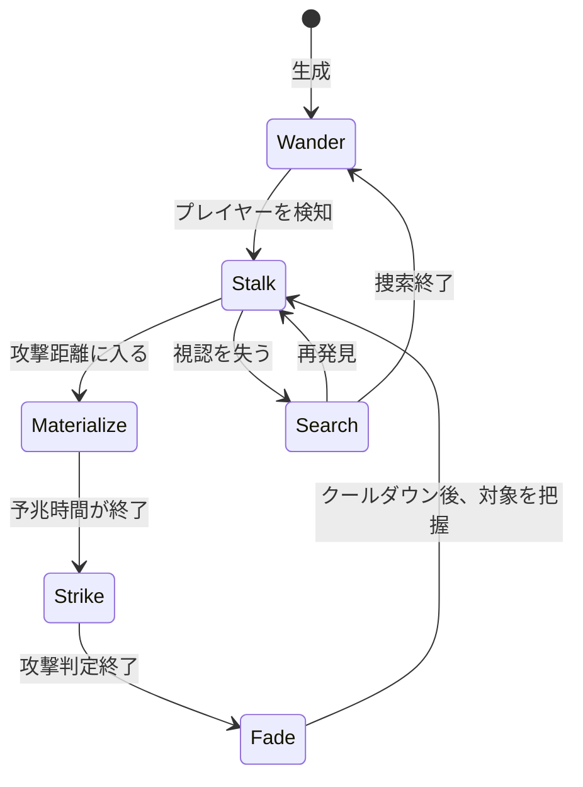

# 幽霊：敵AI・設定仕様案

## この案の狙い

幽霊を「壁をすり抜けて追いかけるだけの敵」にはせず、プレイヤーに位置取りと攻撃のタイミングを考えさせる通常敵として設計する。既存の敵が持つ追跡・突進・旋回とは役割をずらし、**姿を消して接近し、短い予兆のあとに実体化して攻撃する敵**にする。

## プロジェクト内で確認できた前提

- 本作は2Dのダンジョン探索ゲーム。自動生成と手作りマップがあり、ステージごとに敵Prefabと出現数を設定できる。
- 敵AIは一種類ではない。`EnemyAI` は視認、追跡、見失った場所の捜索、警戒を持ち、`HarpyAI` はプレイヤーの周囲を旋回して突進し、`SlimeEnemyAI` はアイテムや特定の敵を探して移動する。
- 通常の敵Prefabには `EnemyHealth`、`EnemyAttack`、`EnemyFaction` などを組み合わせる構造がある。接触攻撃は `EnemyAttack` がクールダウン付きで処理し、プレイヤーへのデバフも設定できる。
- 敵の出現は `EnemySpawner` が `StageData` のスポーン設定を読み、指定Prefabを生成する。幽霊も専用の特殊スポーナーを作らず、まずこの枠に追加するのが自然。
- `EnemyAI` の移動は壁を考慮した局所的なステアリングで、迷路の経路探索を保証するものではない。常時壁抜けさせると、この前提とぶつかり、プレイヤーから安全な遮蔽物を奪いすぎる。
- 世界設定資料では「久遠の迷宮」や、敵ごとの生態・出現場所を定義する書き方がすでに使われている。一方、幽霊について確定した設定は見当たらないため、以下は新規提案。

## 推奨する基本設定

| 項目 | 提案 |
|---|---|
| 名称 | 迷宮の残響（通称：幽霊） |
| 正体 | 迷宮で長く失われた探索者の記憶が、迷宮の魔力に焼き付いて動き出したもの |
| 性質 | 生前の人格や会話能力はほぼ失われ、最後に強く刻まれた「獲物を追う」「出口へ戻る」などの行動だけを繰り返す |
| 生息場所 | 古い区画、行き止まり、長く使われていない部屋。序盤から大量に出すより、静かな区画で少数を初登場させる |
| 見た目 | 薄い人型の影。輪郭や装備の一部だけが一瞬見え、実体化中は顔の情報が読み取れない |
| 音 | 遠くで聞こえる足音や装備音が、接近時に途切れる。攻撃前だけ音が反転・濁るなど、予兆を視覚以外でも伝える |
| 戦闘上の役割 | 耐久力は低め。隠密接近と一撃離脱でプレイヤーを振り向かせ、他の敵や狭い地形との組み合わせで圧力を作る |

「幽霊がなぜ敵なのか」は、迷宮に囚われているから自動的に悪意がある、とはしない。迷宮が記憶を歪めているため、探索者を生前の敵や侵入者と誤認して襲う、という設定にすると、討伐対象としての理由と哀れさを両立できる。

## AI仕様案

### 状態遷移

### 状態ごとの動作

| 状態 | 動作 |
|---|---|
| `Wander`（徘徊） | 部屋や通路をゆっくり移動。プレイヤー未発見時は攻撃しない。既存AIの方向選択・障害物回避を再利用する。 |
| `Stalk`（潜伏接近） | プレイヤーを見つけたら、姿を薄くして追跡。接触攻撃は無効。壁は抜けず、遮蔽物の向こうでは見失う。通常追跡より少し速い程度に留め、背後へ瞬間移動はしない。 |
| `Materialize`（実体化予兆） | 攻撃距離に入ると移動を止め、0.6〜0.9秒ほど姿と音を強める。プレイヤーが避ける時間を確保する。 |
| `Strike`（一撃） | 短い前方攻撃。接触判定を使う場合は攻撃中だけ有効にし、`EnemyAttack` の連続接触で多段ヒットしないようクールダウンを設定する。攻撃後に短い硬直を入れる。 |
| `Fade`（離脱） | 実体を薄くし、短時間だけ接触ダメージを受けない、または被ダメージ軽減。完全無敵を長く続けない。攻撃後にプレイヤーから少し距離を取り、再攻撃まで猶予を作る。 |
| `Search`（捜索） | 見失った最後の位置を調べる。一定時間見つからなければ徘徊に戻る。壁越しの位置を知り続けない。 |

### 攻撃の読み合い

1. 潜伏中の姿・音で接近を知らせる。
2. 実体化した場所と向きから攻撃方向を示す。
3. プレイヤーは移動で避けるか、予兆中に攻撃して妨害する。
4. 攻撃後の硬直が、反撃の時間になる。
5. 幽霊は短く離脱してから再び接近する。

一撃の威力や移動速度だけで難度を上げず、「気配に気づく」「予兆を見て避ける」「攻撃後を狙う」という学習可能なループを主軸にする。

## 初期調整値（仮）

値は既存PrefabのInspector設定を見てから調整するための出発点。確定値ではない。

| パラメータ | 仮値 | 意図 |
|---|---:|---|
| HP | 20〜30 | 通常敵として短い交戦で倒せる範囲 |
| 探知距離 | 7〜9 | 部屋の先から無制限に追跡しない |
| 潜伏移動速度 | 2.5〜3.0 | 既存AIの歩行2.0・追跡3.0前後を基準に、強すぎない追跡 |
| 攻撃距離 | 1.0〜1.4 | 近接武器の間合いと視認性を確認して調整 |
| 実体化予兆 | 0.6〜0.9秒 | プレイヤーが反応できる猶予 |
| 攻撃時間 | 0.2〜0.35秒 | 攻撃判定を短く保つ |
| 攻撃後硬直 | 0.7〜1.0秒 | 反撃可能時間 |
| 再攻撃待ち | 2.5〜3.5秒 | 連続攻撃を防ぐ |
| 離脱距離 | 1.5〜2.5 | 攻撃直後に一歩分の間合いを作る |
| 潜伏時の被ダメージ | 受ける／軽減 | 初版は受ける設定を推奨。隠れているだけで倒せない不満を避ける |

数値はすべてプレイテスト前の仮案。とくに攻撃距離と予兆時間は、プレイヤー移動速度・武器の当たり判定を実機で見て調整する。

## 既存システムとの接続方針

- 専用コンポーネント案：`GhostEnemyAI`。最初は `EnemyAI` の状態機械を拡張するか、`EnemyAI` と共存するかを決め、同一 Rigidbody2D を複数AIが同時に操作しないようにする。
- 攻撃は初版では既存の `EnemyAttack` を使う。`EnemyAttack` は接触中も試行するため、攻撃状態だけCollider/攻撃コンポーネントを有効にするか、攻撃判定専用Colliderを用いる。
- 死亡・HP・ドロップ・攻略ポイントは `EnemyHealth` に任せる。幽霊専用の死亡処理は初版では増やさず、見た目のフェードは既存の死亡演出と干渉しない形にする。
- `EnemyFaction` を既存値に合わせて設定し、味方・他勢力との攻撃関係を明確にする。
- Prefabを `EnemySpawnSettings` に登録し、出現ステージ・最大数・出現モードを設定する。手作りマップでの出現有無もステージ設定に従う。
- 透明化は `SpriteRenderer` のアルファで行う場合、ヒットフラッシュ等が色を上書きする既存演出との競合を確認する。将来は専用の表示制御コンポーネントへ分離できる。

## 避けたい仕様

- 常時壁抜け、プレイヤー位置への瞬間移動、長時間の完全無敵を同時に持たせる。既存の局所ステアリングでは挙動が予測しにくく、ダンジョンの壁や逃げ場所の意味も薄くなる。
- 予兆なしの接触ダメージ。プレイヤーが攻撃を受けた理由を読み取れない。
- プレイヤーが攻撃可能な間ずっと透明。可視性と反撃機会を両立させる。
- 高HPと高速連続攻撃。幽霊らしさは硬さではなく、出現と消失のリズムで出す。
- 特殊ギミックを初版から積み上げすぎる。壁抜け、憑依、装備封印、恐怖ゲージなどは、基本ループが面白いと確認してから追加する。

## 実装を始める順序

1. 既存の敵Prefabを一つ選び、`EnemyHealth`、`EnemyAttack`、Rigidbody2D、Collider、Factionの構成をテンプレートとして確認する。
2. `GhostEnemyAI` に徘徊・接近・予兆・攻撃・硬直・再接近の状態だけを実装する。
3. 攻撃以外の時間は接触判定を無効化し、多段ヒットと透明中の不意打ちを防ぐ。
4. `EnemySpawnSettings` で少数出現させ、部屋の広さと視認性を変えて遊ぶ。
5. 避けやすさ、反撃しやすさ、幽霊の見失いやすさを調整してから、設定上の生態・ドロップ・追加能力を固める。

## 未決定事項

- 幽霊は元探索者なのか、迷宮が作った模造人格なのか。
- 幽霊が倒された後に解放されるのか、単に霧散して再形成されるのか。
- 幽霊を出す階層・地形・勢力との関係。
- 幽霊固有のドロップを持たせるか。最初は通常ドロップにし、世界設定と報酬設計を分けて検討するのがよい。
- 壁抜けを将来入れる場合、常時能力ではなく「攻撃後に短く壁を横切る」など、予告と回数制限のある移動にするか。

## 推奨する最初の完成形

**「薄く姿を隠して追い、実体化の予兆を出して一撃を放ち、外すと硬直する迷宮の残響」**を第一版とする。壁越し探知や常時無敵を持たせず、既存の視認・追跡、EnemyAttack、EnemyHealth、EnemySpawnerを利用する。これなら既存敵との違いがはっきりし、専用AIスクリプトの範囲も抑えられる。
