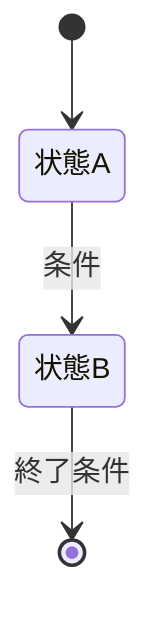

# はじめに
現在、私のスクラッチアカウント「take_take」にて、久遠の迷宮（無限ダンジョンの攻略）のモンスター募集をしました。[https://scratch.mit.edu/projects/1382505113](https://scratch.mit.edu/projects/1382505113)  
なお、Unityで開発している久遠の迷宮ですが、スクラッチ版（こっちが元）があります。[https://scratch.mit.edu/projects/1169722485/](https://scratch.mit.edu/projects/1169722485/)  
そして、そのモンスター募集ですが、たくさん応募していただき、リミックス数が36まで行きました。（作品数なので、一人が何個もやってたり作品に複数のモンスターを入れてたりする　）

# 要素

一応、このゲームにどんな要素があるかをまとめておきます。

2D見下ろし　XY軸に移動する
ランダムマップと固定マップ
部屋（ランダムマップ）自由に作れる
ドロップ（ステージ固有のアイテム＋モンスターの固有のアイテム）
エネミーAI（ボス以外の基本的なエネミーは常にマップ上探索し、プレイヤーを見つけて攻撃する。）
水源（入ると移動速度が低下する。水に入れないモンスターと入れるモンスターがいる。ダメージをいけるものもいる）
水生（地上へ行けない。そして水でゆうり）
剣（剣はマウスの方向に飛ぶ。ある程度は自由に攻撃する方向、遠さを決められる）
盾（ダメージを完全ではないが防ぐ。）
防具（同上）
バフとデバフ（アイテムを使ったり、モンスターに攻撃されることで発生さまざまな状態変化を起こす）
マグマ（水よりもさらなる移動速度の低下、そして強いダメージ）
奈落（即死）
死亡（ステージのどこかに再リスポーン固定スポーンの場所もあるそのとき、レア度に基づき、基本的に半分またはそれ以下のアイテムを落とす。）
アイテム（落ちたアイテムは拾える。）
バリケード（モンスターを邪魔する。モンスターは諦めることがある）

# 諸注意

応募の内容は、モンスターのデザイン、名前、説明、差別化内容（特有な能力等）です。

その内容から、設定を広げていってください。
この時、曖昧に言うのはやめてください。設定を広げて、具体化してください。

1. 独自性：ほかのモンスターと区別できるか。
2. ゲームとの相性：見下ろし型2Dアクションの小さな画面でも、敵だと認識できるか。
3. 直感性：独自性と対になるが、ぱっと見でわかりやすいか
4. 応募者の原案の尊重：デザインの魅力を残しながら実装できるか。

マークダウン方式でやってもらいます。また、表示はオブシディアンで表示するので、オブシディアンの記述方式でもあります

ファイル名はそのモンスターの名前だけになります。

ファイル名は見出しで表さないで。勝手に私がつけます。

参考にしたものをURLでまとめてください。

# 推奨

以下は推奨です。
- モンスターの名前は、ギリシャ語や、英語、また、神話（特にヨーロッパ）を参考にする。（これはそのまんますぎる名前の時変えるようにする）
 - ウィキペディアっぽい感じにする
- めちゃくちゃ細かくいう
  曖昧なことを言わないで

# 絶対注意(警告)
曖昧にしないでと内海も言っていますが、ただし、それは「物語的設定」です。「ゲーム的設定」つまり、HPや攻撃力などは、ゴブリン何人分かで表してください。
必ず出力はマークダウンで出してください。お願いします。
オブシディアンの機能を使ってください。
他モンスターとの関係などを書いてください。この時、オブシディアンの記事とのリンク機能を使ってください
プレイヤーや、倒す方法、出現受験、どこぐらい（序盤など）で出るかなどを書いてください
名前は、実際の文字（アルファベット等）と、発音（カタカナ）を提示してください。
コードブロックで出力して

# ゲーム要素 設定・実装テンプレート

モンスター、アイテム、装備、ギミックなどを考えるときに複製して使う。未確定の項目は「未定」、該当しない項目は「なし」と記入する。設定と実装仕様を分け、ゲーム内での役割やプレイヤーに見える挙動が伝わるようにする。

---

# 概要

## 基本情報

- **要素名（発音カタカナ）**：
- **要素名（内部名・英文字）**：
- **分類**：モンスター / アイテム / 装備 / ギミック / その他
- **状態**：アイデア / 設計中 / 実装中 / 実装済み / 要調整
- **関連する設定・要素**：

## コンセプト・世界設定

- **一言コンセプト**：
- **世界での由来・背景**：
- **生息地・入手場所・出現条件**：
- **見た目・大きさ・色**：
- **性格・生態・用途**：
- **プレイヤーに伝えたい印象**：

# 物語的設定

- 起源
- 影響
- 他モンスターとの関係など 
- 進化
- 迷宮との関係
## ゲーム内での役割

- **プレイヤーが遭遇・入手する状況**：
- **ゲームプレイ上の役割**：
- **プレイヤーに促す判断・行動**：
- **他の要素との違い**：
- **想定する難易度・進行段階**：

## プレイヤーから見える仕様

- **通常時の挙動・効果**：
- **発動条件・操作方法**：
- **発動前の予兆・表示**：
- **効果時間・クールダウン**：
- **解除・終了条件**：
- **失敗時・無効時の挙動**：
- **撃破時・使用後・取得時の結果**：

## 数値・バランス

| 項目              | 値・範囲 | 補足  |
| --------------- | ---- | --- |
| HP / 耐久度        |      |     |
| 攻撃力 / 効果量       |      |     |
| 移動速度 / 射程       |      |     |
| 発生確率 / ドロップ率    |      |     |
| 重量 / スタック数 / 価格 |      |     |
| その他             |      |     |

※ 数値はゴブリン何人分かで判断

## 実装仕様（Unity）

### 挙動の流れ（探索や、攻撃なども入れる）

1. **開始条件**：
2. **通常処理**：
3. **終了条件**：
4. **終了後の処理**：

### 状態遷移（必要な場合）

## 演出・操作感

- **アニメーション・見た目の変化**：
- **効果音・BGM**：
- **エフェクト**：
- **UI・ログ・説明文**：
- **操作・フィードバック上の注意**：

## 例外・確認項目

- **同時発生・連続使用時**：
- **壁・段差・画面外など地形との関係**：
- **死亡・ステージ移動・一時停止時**：
- **他の効果との重複・競合**：
- **プレイヤーに誤解されそうな点**：

# 関連記事・参考ページ

## 作業メモ

- **未決定事項**：
- **実装・調整タスク**：
- **確認方法（どの場面で何を見るか）**：
- **関連ファイルへのリンク**：
- **更新日**：